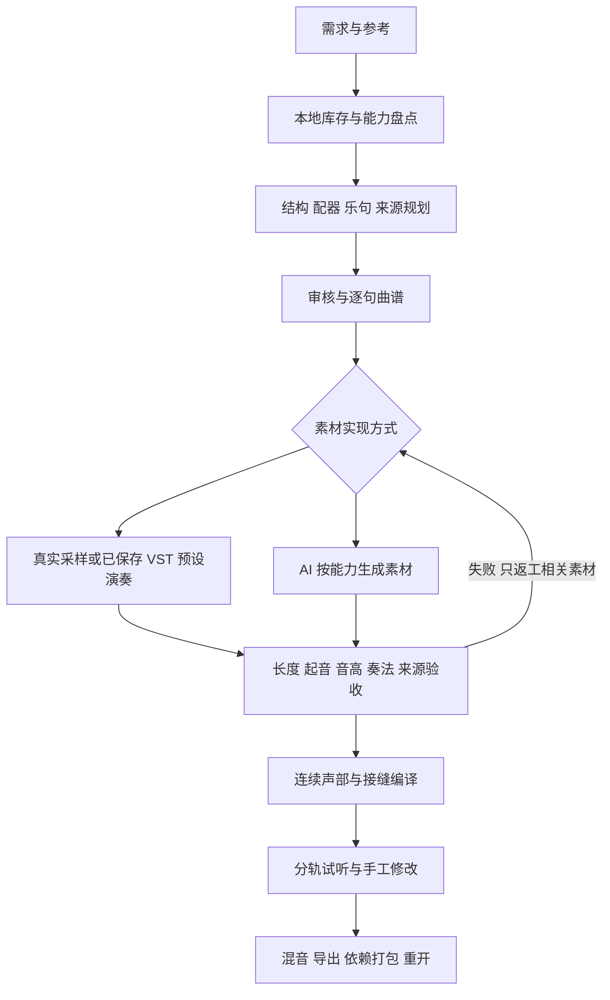
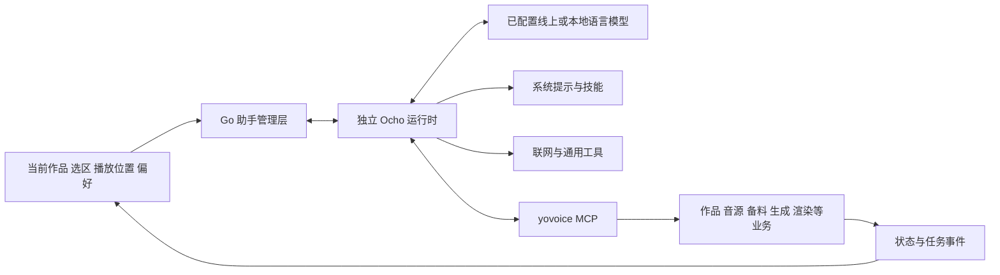

# 智能编曲与 Ocho 深度分析及问题报告

日期：2026-10-20。范围：本机定制版、实际作品和官方 v0.3.0—v0.3.1 源码差异。

配套文档：[未来迭代规划](./intelligent_arrangement_next_plan_20261020_zh.md)。本报告取代此前报告中对“流程已接通即可使用”的过宽判断。

## 1. 结论与证据等级

系统已经具备规划、逐句写谱、真实采样、AI 乐句、VST 预设、备料任务和时间线等基础，但缺少一套贯穿这些环节的“音乐交付合同”。有文件、有按钮、有工具，仍不能证明生成了指定乐器、指定长度、按谱对齐且衔接自然的素材。

最严重的问题集中在三处：

1. **AI 素材的实际内容与时间合同没有严格闭环。** 当前合唱计划需要 9 秒，实际文件 171.44 秒；允许人工确认后取前 9 秒使用，不能保证这就是正确的 9 秒。
2. **曲谱、演奏实例和音频片段之间缺少连续演奏语义。** 乐句是规划单位，却也容易成为独立生成、重起音和硬裁切单位；连奏、尾音、呼吸、和声上下文没有完整传递。
3. **Ocho 有工具调用运行时，但新增工作流、内置技能与授权/验收入口没有完全对应。** 可以调用一些环节，尚不能据此宣称可靠完成自主找源、审核、制作、校准和交付。

证据等级在全文中区分如下：

| 标记 | 含义 |
| --- | --- |
| 已复现 | 针对实际路径运行了失败用例，并可观察相同现象 |
| 数据确认 | 只读查询当前数据库或检查实际文件得到的事实 |
| 代码确认 | 可以指出实现中的明确行为，但未证明每首作品都出现该听感 |
| 待验证 | 需要模型真实运行、音频对比或插件实机演奏才能下结论 |

浏览器实际播放测试可以验证文件解码、播放和跳转；它不等于对音乐好坏的试听评价。MCP 和假运行时测试可以验证协议与业务约束；它不等于 DeepSeek 驱动真实 Ocho 全程成功。

## 2. 本次实际核对了什么

- 截图中的合唱 WAV：约 32 MB，PCM16、双声道、48 kHz，时长 171.4387 秒，文件存在。
- 数据库以只读方式检查，未改写作品、采样或 API 配置；当前有 4 个带智能编曲计划的作品、15 个音源记录和 1 个 AI 乐句素材。
- 两个播放页面及搜索切换的真实浏览器解码测试，没有把 `play()` 替换成总是成功的函数。
- 已拼合作品新建为空白编曲的回归：修复前仍残留 12 条旧轨道，修复后清空。
- 曲谱面板的高度调节、收起和展开；AI 素材与模型分类；当前目录与文件路径显示。
- Ocho 的进程启动、MCP 桥接、工具注册、编曲工具调用、修改保护和内置技能。
- 官方最新发布及 v0.3.0 到 v0.3.1 文件差异。

可复核证据在 `artifacts/arrangement-audit/`：`instrument-playback-red-confirmed.log`、`instrument-real-choir-range.log`、`score-dock-red.log`、`library-dock-green.log`、`current-workflow-readonly.json`、`ocho-workflow-tests.log`、`official-latest-release.json`。这些是本地调查材料，不作为公开上传内容。

## 3. 当前流程与理想流程的差距

当前代码已经覆盖图中的多数节点，但“素材验收”和“接缝编译”明显薄弱。后续应优先增强这两层，而非继续堆音源站和生成按钮。

### 3.1 需求与参考

**已有：** 文字需求、目标时长、真实/AI/混合模式、参考音频与参考谱入口。

**问题：** 输入框的最新要求、已审核计划和已准备素材属于不同对象；修改需求不代表旧计划已更新。用户容易以为“我改成了 60 秒”，后台仍按旧计划生成。

**处理方向：** 明确显示“需求已改，计划待更新”；保留旧成果，但将其标记为上一修订。参考音频还要区分分析对象、演奏素材和音色参考，不能因上传参考就认为可直接演奏或复制其音色。

### 3.2 库存与来源规划

**已有：** 已下载优先、绑定身份检查、同类候选、手动替代、插件来源标记和文件健康检查。

**问题：** “真实/AI”同时承载来源属性与实现路径。例如 VST 可以播放真实采样，也可以合成模拟；AI 生成音频可以是完整乐句，也可以是可映射键盘的单音。这些对象不能共用一个笼统的可用状态。

**处理方向：** 分开记录“声音来源”和“演奏/生成后端”。搜索结果、已下载文件、有效采样、可用预设、通过验收的乐句应有不同状态。

### 3.3 配器与写谱

**已有：** 服务端声部 ID、逐乐句约束、源身份/音域/奏法/力度检查、局部写谱进度。

**仍缺：** 乐句间的旋律动机、和声连接、呼吸点、共同节拍摆动、声部持续性、不同乐器的演奏语法。

仅有“每个音符都落在音域内”不足以判定自然。琵琶轮指、箫的气口、弦乐连弓都涉及连续时间中的动作；把一串普通 MIDI 音符加上“轮指”文字，不会自动产生相应奏法。

此外，声部在某句中的身份应与跨句持续存在的“演奏者/乐器实例”分开。否则逐句创建轨道可能让 VST 预设、包络和采样起音在每个边界重新开始。

### 3.4 备料任务

**已有：** 持久任务、逐项完成登记、重启恢复、局部缓存和修订保护。这些是应保留的基础。

**问题：** 任务成功主要说明获得了文件或完成技术步骤；不能表示乐器正确、音乐对齐、成品长度正确、试听通过。后续单句失败保留前几句是对的，但每句还需有独立的质量状态。

**建议状态：** 已生成原始文件 → 自动检查 → 待对齐/待裁切 → 待试听 → 已验收 → 可拼合。对齐失败应定位到一句，不应要求重做整曲。

## 4. 两个最初故障的根因及本次修复

### 4.1 合唱不能播放：已复现并修复

`InstrumentLibrary` 在列表与详情中分别渲染 `<audio>`。页面切换会重新创建媒体元素，但 React 状态仍保留“已经选中这个素材”。再次播放时按已选中分支直接调用 `play()`，新元素却没有音频地址；搜索变为空列表也会卸载播放器。

修复内容：

- AI 播放器移到子页面和空列表之外，列表/详情切换保持同一实例。
- 重试检查媒体元素的实际地址和错误状态，必要时重新加载。
- 切换其他分类或进入真实采样试听时暂停 AI 播放，避免同时发声。
- 保留进度拖动，失败写入播放诊断；不再一律误导为需要重新下载。
- 用真实 171 秒文件验证播放、切页和拖动；原文件未被转换或覆盖。

对应：`web/src/features/instruments/instrument-library.tsx`；回归 `web/browser-tests/instrument-playback.spec.ts`。

### 4.2 查看采样缺少位置：本次增加

- 音源信息显示当前存储目录；各采样显示完整文件路径。
- AI 素材详情显示对应输出文件路径。
- 插件音色显示插件实际位置，不伪造一个采样目录。
- 使用 `storage.info` 返回的数据目录，迁移存储位置后随之变化；长路径换行并支持选中复制。
- 未下载条目不声称已有本地文件。

位置显示只回答“记录对应哪个路径”；文件是否健康仍由预检判断。后续可增加定位文件、校验与修复入口，但不能拿“能显示路径”替代“文件可用”。

## 5. 新建作品为何出现暗夜圣咏轨道

### 5.1 已复现的根因

工作台底部同时渲染 `ScoreDock` 与 `TimelineEditor`，两者用了相同的 `key={draft.id}`。它们是同级组件，同一个标识会破坏 React 列表协调；切换到新作品时可能留下旧 DOM。

回归中，新作品概要已经显示“0 小节”，下方仍存在上一首的 12 条轨道。这证明至少该复现是**界面残留**，不能据此判断新作品数据库已经复制了旧曲谱。

已将标识拆为 `score:<作品ID>` 与 `timeline:<作品ID>`。没有通过删除旧作品、清空数据库或强行刷新掩盖问题。

### 5.2 高度为何挤压上方

原曲谱区最大 45vh，音频区另有独立高度，合在一起可能挤掉主编辑区；残留多份曲谱时更严重。

本次增加曲谱高度拖动与收起/展开，并给底部面板设置共同高度预算，上方作品信息保留空间。不同窗口高度仍需回归，不能只在大屏截图里判断布局正常。

另一个尚需长期处理的问题是“重规划”：新建作品和在同一作品里重新规划不同。重规划应把旧乐谱、音频和手工编辑标成上一修订，不能悄悄显示成新方案成果。

## 6. AI 是否能按指定长度生成音源

### 6.1 当前实际发生的事情

《暗夜圣咏 · 哥特挽歌》的“合唱涌入”：

| 指标 | 当前值 |
| --- | --- |
| 计划速度、拍号 | 80 BPM、4/4 |
| 乐句目标 | 9.0 秒 |
| 原始生成文件 | 171.4387 秒 |
| 实际/目标比 | 19.05 倍 |
| 阈值检测的起音 | 约 0.532 秒 |
| 曲谱该句首音位置 | 0 秒 |
| 当前处理 | 超长提示，试听确认后默认取文件前 9 秒 |

起音检测只是波形阈值，不等于完整的音乐事件对齐。即便如此，这个偏差也足以说明必须校准；不能直接把“有 ABC 条件”当成逐音符对齐证明。

### 6.2 模型适配的真实边界

`arrangementAIJobs` 按乐句小节、拍号和计划速度计算时长。`arrangementMusicDraft` 给 ACE-Step 设置至少 10 秒的生成参数，给 YuE2 传入该句 ABC；当前没有证据证明 YuE2 能凭这个接口精确输出 9 秒。

进一步只读重建当前合唱条件：第 18–20 小节，4 个器乐旋律音符，ABC 转换前后都是 3 小节、9 秒。因此当前条件转换没有把长度变成 171 秒；这仍是对当前修订的重建，不能冒充捕获到了原始生成请求。

**引擎实际上有可接入的长度控制。** 安装包中的 YuE2 模型规范提供 `semantic_min_tokens` / `semantic_max_tokens`；引擎 v0.9.1 文档说明语义流为每秒 25 帧。9 秒对应约 225 帧，另需明确是否包含前缀和尾音。当前 yovoice 参数白名单没有暴露这两个选项，编曲适配器也没有设置它们，所以单纯在页面填写秒数并未形成底层长度约束。[引擎官方文档](https://raw.githubusercontent.com/0xShug0/audio.cpp/v0.9.1/docs/models/yue2.md)。

本机模型的语义最小/最大 token 配置为 200/9000，允许远长于 9 秒的输出。171.44 秒不等于证明打满了 9000 的上限；不能在没有原始语义 token 记录时这样归因。帧数限制能约束流长度，也不自动保证乐句完整、合唱正确或音乐自然，仍须真实模型验收。

因此“指定时长”需要拆成三个值：

1. 编曲需要的**音乐有效长度**；
2. 模型实际请求的**生成长度**；
3. 校准后可用的**成品长度**，并单独保留尾音。

支持时长参数的模型可以按能力请求目标；不支持的应诚实显示限制，并通过较长生成、有效区段选择、对齐和必要的重生成获得成品。不能默默高速拉伸 171 秒到 9 秒，这会严重改变演奏。

ACE-Step 的上游能力还不等于本机 audio.cpp 适配器已支持所有参数；应以当前引擎与模型实测能力为准。[ACE-Step 官方项目](https://github.com/ace-step/ACE-Step-1.5)、[YuE2 论文](https://arxiv.org/abs/2609.33757)可作为模型研究依据，不能代替安装版验收。

### 6.3 合唱需求与提示词存在冲突：代码确认

当前统一素材提示包含 `No vocals`，同时使用 `Instrumental: true`；引擎还会追加纯音乐方向。对“无词合唱/哼唱”而言，这与声部名称冲突。

这说明要先分类声音任务：器乐、无词人声、打击/效果、环境纹理。无词人声不应被解释为“没有人声”。本次尚未据此重新生成合唱，也不能声称现有音频一定含正确合唱声部；需要实际试听或进一步分析。

### 6.4 不能把 AI 乐句等同于通用音色

完整乐句适合摆到时间线；单音、多音高多力度、持续音循环、奏法采样才适合做可编辑乐器。要生成“可演奏 AI 音色”，还需稳定音高、起音/循环/释放区、根音和力度映射、奏法验证。整首生成模型不应默认承担所有这些任务。

## 7. 拼合为什么可能一顿一顿

### 7.1 已确认：成品区段选择不足

AI 目前超长音频默认从开头取一段。开头可能有前奏、静音、错误配器或未进入主题，9 秒截取又可能切在持续音中间。当前 171→9 秒案例是直接证据。

### 7.2 已确认：淡化字段与实际渲染不一致

拼合代码写入 `FadeIn` / `FadeOut`，但当前前端 `Timeline.schedule` 没有使用这些字段。官方前端类型兼容测试也将其视为旧字段、读取时忽略。新增编曲逻辑沿用了这些字段，却没有接入实际增益曲线。

所以不能说“已经自动交叉淡化”。即使补上字段，也不应给同一连续素材的每个切点强加淡出/淡入，那会制造音量凹陷。需要区分连续切片、不同演奏拼接、正式换句和有意留白。

### 7.3 代码风险：采样按音符重新起音、持续方式有限

`internal/score/sample.go` 对每个音符从采样起点读入，采样读完即停止；当前没有通用持续循环或真实连奏过渡层，并在音符末尾施加短释放包络。这个实现足以预览或简单采样演奏，但不等于专业采样器。

对短音、拨弦可能合适；对弦乐长音、箫的持续气息、跨音连奏，可能产生重复起音、尾音被裁、长音后段变空等问题。这是明确的算法限制，是否正好解释当前某一处顿挫，需要按分轨检查，不能仅凭乐器名称定案。

### 7.4 代码风险：同一演奏者跨句被拆成多个实例

真实/VST 渲染按轨道 ID 与音源 ID 分组。若同一乐器的相邻乐句分配到不同轨道，预设状态和演奏上下文会重启；需要稳定的跨句演奏实例 ID。

反过来，同一素材的连续切片未必有问题：当前小提琴作品有 9 个同文件、源偏移连续的接点，圣咏工程有 3 个这类接点。**接点数量不能直接证明掉音。** 应先核对源波形和排程连续性，再确定是采样音符、曲谱休止还是拼接算法造成。

### 7.5 代码风险：音乐时间基准分散

AI 目标长度按计划固定速度计算，曲谱和时间线则还可能涉及段落速度。这里已有保护：`arrangementUnits` 会比较乐句实际曲谱长度与固定速度预期，偏差超过 0.1 秒时拒绝拼合；基础速度和拍号不一致也会被拒绝。因此当前主要表现为变速支持受限，不能直接断言已经静默错位。后续支持变速时应统一节拍到采样帧的转换，保留现有拒绝保护直到新时基验收完成。

### 7.6 待验证：音乐本身与混音因素

- 逐句独立生成缺少上一句尾部与和声上下文，音色和混响空间容易变。
- 每音独立随机时移可能破坏同一演奏者的节奏；“更随机”不等于自然。
- 真实采样与 AI 音频响度、起音、混响和声像不同，交接时容易暴露拼贴感。
- 波形有削波、噪声或不稳定高频时，单纯高频柔化只能缓解听感，不能恢复被破坏的声音。

### 7.7 建议的分轨诊断顺序

1. 导出或试听单个真实声部，确认不加 AI 也是否顿挫。
2. 对同一接点比较源文件连续区段与拼合输出。
3. 对 AI 乐句单独比较预定首音、检测起音、节拍和有效区段。
4. 检查持续音尾部、采样长度和乐谱休止，不把正常气口当故障。
5. 最后再叠加其他轨道，判断响度与空间交接。

本次没有直接改写用户的合唱、曲谱或拼合结果；避免在原因未定位前用统一拉伸、随机化或强降噪改变作品。

### 7.8 实际波形与乐谱补查

只读检查两个已拼合工程的 19 个同轨相邻接点，文件全部可读取。小提琴独奏的 9 个接点都是时间线无缝、同文件且源偏移连续；不能把这些位置的顿挫归为“时间线额外插入空白”。

| 小提琴位置 | 谱面休止 | 接点前 20 ms RMS | 接点后 20 ms RMS | 能确认的事实 |
| --- | --- | --- | --- | --- |
| 18 秒 | 0 秒，69→69，均为 sustain | -28.49 dBFS | -65.27 dBFS | 源音频自身有明显短时能量下降 |
| 24 秒 | 0 秒，62→62，均为 sustain | -48.69 dBFS | -75.64 dBFS | 不能靠合并时间线切片恢复连奏 |
| 42 秒 | 0 秒，88→81，均为 sustain | -19.67 dBFS | -52.25 dBFS | 需要检查音符换音与演奏包络 |

这些短时能量值不能单独证明某个下降一定不符合音乐意图，但已将调查位置从“时间线多了空隙”缩小到源演奏及其音符起止。当前该轨设置了每音独立的 ±12 ms 时移；相邻音理论上可额外分离约 24 ms，再叠加末端 25 ms 释放与下一音重新起音，会暴露缺少连奏策略的问题。随机时移的理论界限不等于已经测出了每个接点的实际空白长度。

圣咏工程另有 7 个正间隔，约 9–39 秒，均对应同轨源偏移也跳过相同区间；它们是该乐器不在整首中连续发声的候选位置。仍需结合每个声部计划判断是否有意休止，不能把这些间隔一律自动补满。

复核材料：`wave-join-readonly.json`、`violin-boundary-score.json`、`choir-phrase-contract.json` 和 `choir-phrase-condition.abc`，都位于本地调查目录。

### 7.9 新发现：调性标签在 ABC 中静默回退

当前计划、乐谱与 AI 素材记录均标注 `D minor`，但重建的条件是 `K:C`。`PhraseABC` 只接受 ABC 调性缩写，未识别 `D minor` 后直接回退 C；正确可表示的形式应为 `Dm`。

音符逐音高回读校验仍通过，因此这不表示所有旋律音高被改成 C 大调；实际丢失的是调性上下文，可能影响模型对和声与伴奏的理解。这是“音符正确但音乐条件不完整”的具体例子。需要统一常见调性别名并拒绝静默回退；中国调式应保留原含义，不能把宫调式直接冒充西方大调。

## 8. 官方 Ocho 究竟是什么

### 8.1 架构判断

它具备 agent 运行时的结构：Go `Manager` 启动独立 Ocho 可执行程序，使用流式 JSON 协议；传入模型、系统提示、允许工具；通过 MCP 桥接回应用业务，读取技能文件，接收界面上下文和事件。

允许的通用工具包括文件读写/搜索、命令行、`WebFetch` 和 `WebSearch`，Windows 另有 PowerShell。应用状态修改要求走 yovoice 工具，不能靠直接改数据库实现。

因此它具有与 Codex 一类工具调用系统相似的组成，但不能仅凭 CLI 参数推断它与 Codex 或某个 DeepSeek harness 具有相同内部实现、能力和可靠性。[官方源码](https://github.com/leemysw/yovoice/blob/v0.3.0/internal/assistant/assistant.go)支持上述进程与桥接判断。

### 8.2 官方现有能力

| 领域 | 能做的事情 | 边界 |
| --- | --- | --- |
| 作品 | 列表、读取、新建、补丁修改、打开作品 | 需要明确目标，先读后改 |
| 语音与故事 | 修改文本、角色、声音参数、逐角色设置和发起生成 | 受已安装模型、参考音色和参数范围限制 |
| 歌曲 | 写词、风格、纯音乐参数、YuE2 旋律谱与生成 | 生成是后台任务，启动不等于完成 |
| 普通编曲 | 创建/修改曲谱，SF2 渲染 | 不天然包含新增混合音源流程 |
| 诊断 | 应用状态、近期错误、模型盘点 | 不等于已经听懂生成音频 |
| 偏好 | 保存、读取和移除长期偏好 | 偏好不是本次具体方案审核 |
| 高影响操作 | 通过确认卡申请删除、下载和资源变更 | 不应绕过业务确认 |
| 联网 | 运行时开放搜索/抓取工具 | 可调用不代表每个供应商都可用，也不代表已下载和验证音源 |

### 8.3 定制版确实新增了八个业务工具

| 工具 | 连接到的真实业务 | 还缺什么 |
| --- | --- | --- |
| `arrangement_inventory` | 本地来源、健康、采样和插件盘点 | 查询/分页、按用途返回、候选与依赖摘要 |
| `inspect_arrangement` | 逐句来源与可演奏检查 | 阶段参数、素材质量、衔接诊断 |
| `bind_arrangement_source` | 正确绑定与替代保护 | 独立解锁/撤销等用户动作的完整协议 |
| `plan_arrangement` | 调用规划并保存未审核方案 | 方案修改、审核状态及改动说明闭环 |
| `compose_arrangement` | 按已审核计划写谱 | 跨句音乐连续性和局部编辑协议 |
| `prepare_arrangement` | 持久备料任务 | 素材对齐、长度合同与质量结果 |
| `arrangement_jobs` | 查询真实任务状态 | 事件推送、清楚的等待/恢复策略 |
| `render_arrangement` | 预检后拼合 | 接缝编译、混音与成品验收 |

注册、允许列表、MCP 桥接和绑定约束测试均已检查。但这证明的是接口可达，不代表语言模型会稳定按正确顺序使用全部工具。

## 9. Ocho 尚未打通的关键卡点

### 9.1 技能与新工具冲突：代码确认

`yovoice-workflows` 的配乐流程仍主要是创建 score → `update_work` 写谱 → 选择 SF2 → `generate_work`。系统提示会让配乐任务加载这套技能。新增八工具虽然可见，缺少对应的完整智能编曲技能路由，模型可能沿旧教程行动。

应保留普通编曲流程，同时明确识别“真实采样/混合来源/库中音源/VST”等意图，将其路由到新增业务。更新提示词只是一部分，还需业务端阻止错误路径冒充成功。

### 9.2 审核门与工具链不完整：代码确认

写谱和备料要求计划已经审核；规划工具保存的是未审核方案。通用 `update_work` 没有完整的 `arrangement` 补丁/审核接口。因此助手目前需要用户在页面处理关键步骤，不能声称无人值守全程。

正确方向是有版本摘要的审核动作和撤回动作，可在聊天中呈现计划卡片；不是让助手自行把 `approved` 改成 true。

### 9.3 联网候选无法自动变成可靠音源：代码确认

通用 `WebSearch` 能找网页，但当前八工具没有对等的候选检索、许可记录、可信下载、验音、入库完整链。助手也被要求不得直接修改应用数据目录。缺少业务入口时，搜索结果只能停在候选阶段。

需把网站链接、可下载包、审核后的采样、可播放音色分别建模。登录网站走用户完成的官方登录/下载，再导入；不让模型索要密码或照搬第三方网页中的指令。

### 9.4 VST 操作尚非任意自主操作

已保存、验证过的预设可以由业务渲染；任意插件的原生界面控件、音色包安装、登录和授权并没有统一的模型可操作协议。不同插件有不同的预设、keyswitch 和 CC 约定。

要让 AI 选择音色，先建立经过试听确认的预设清单与奏法映射。宿主测试音成功、预设试听成功、完整 MIDI 演奏成功是三个不同验收项。

### 9.5 缺少统一编曲状态与自动纠错闭环

工具返回“已启动”，下一步应等待并读实际结果。当前持久任务已存在，但 Ocho 仍需知道何时等待、何时重试、哪些结果过时，以及遇到不支持的模型该如何解释并提供候选。

应由应用保存可恢复的任务依赖与实际结果，而不是依赖一段长对话记住所有状态。线上模型负责判断与规划，业务引擎负责可重复执行、校验和恢复。

### 9.6 音频质量认知不足

当前工具能返回时长、起音、峰值等信号，尚不能据此判断“像真人”“像箫”“有轮指”“乐句顺畅”。需要音乐分析服务返回可复核的检测结果和置信度，再让助手提出局部调整；不能把模型的文字描述当听过音频的证据。

## 10. 官方 v0.3.1 的影响

本次核实的最新发布是 v0.3.1，发布于 2026-10-20 01:14 UTC。主要是 macOS 标题栏启动崩溃，以及 Windows 长页面黑色遮挡/滚动条问题。[官方发布说明](https://github.com/leemysw/yovoice/releases/tag/v0.3.1)。

比较 v0.3.0 与 v0.3.1 的文件，没有新增智能编曲业务或 Ocho 编曲工具。此次已纳入 Windows 系统标记、禁用有问题的滚动蒙版和细滚动条的前端修复。

这些修复有助于看到完整页面，不能解决 9 秒乐句生成 171 秒、预设不会演奏或助手工作流冲突。当前仍是定制整合版本，不能将其说成未修改的官方 v0.3.1 安装包。

## 11. 问题优先级清单

| 编号 | 级别 | 问题 | 证据 | 状态 |
| --- | --- | --- | --- | --- |
| U01 | P0 | 新建后残留旧轨道 | 12 轨回归复现 | 本次修复 |
| U02 | P0 | AI 素材切页后不能播放 | 实际媒体路径回归 | 本次修复 |
| U03 | P1 | 面板挤压主信息、不能收起 | 截图与布局实现 | 本次增加调高/收起 |
| L01 | P1 | 采样位置不可见 | 详情实现 | 本次增加 |
| L02 | P1 | AI 素材与模型混排 | 列表实现 | 本次分类 |
| A01 | P0 | 生成长度与需求相差 19 倍仍可采用 | 当前工程 | 待模型适配与成品合同 |
| A02 | P0 | 合唱被统一要求无 vocals | 提示与引擎实现 | 待按声音任务分类 |
| A03 | P0 | 淡化参数未进入实际时间线渲染 | 播放/导出实现 | 待统一接缝引擎 |
| A04 | P1 | “跟谱”缺少可测对齐证明 | 素材登记方式 | 待质量能力分级 |
| M01 | P1 | 采样器持续、连奏和释放能力不足 | 演奏实现 | 待采样器/VST 能力扩展 |
| M02 | P1 | 逐句演奏实例与连续声部不统一 | 渲染分组实现 | 待实例模型 |
| M03 | P1 | 变速曲谱当前被固定时长保护拒绝 | 时长计算与拒绝路径 | 待统一时基，保留保护 |
| A05 | P1 | D minor 条件被静默写成 K:C | 当前乐句重建与调性查表 | 待别名归一与显式限制 |
| O01 | P0 | 内置技能引导 SF2，与混合流程冲突 | 技能内容 | 待专用技能及业务路由 |
| O02 | P1 | 聊天审核、计划修订协议缺口 | MCP 输入定义 | 待审核工具 |
| O03 | P1 | 候选搜索到验音入库缺少助手接口 | 工具清单 | 待候选/获取业务 |
| O04 | P1 | 任意 VST 原生界面无统一自动操作 | 插件能力边界 | 待预设与奏法注册 |
| W01 | P1 | 改需求/重规划后的旧成果呈现不清 | 状态依赖结构 | 待版本状态图 |

## 12. 这次能确认到哪里

可以确认播放故障和旧轨道残留的具体根因，并以针对性回归验证修复；能确认合唱时长异常、起音提示、旧淡化字段未生效和 Ocho 技能冲突。

尚不能确认：现有合唱的乐器/人声内容准确性、全部顿挫发生点、任意模型是否精确遵守秒数、任意 VST 是否能全自动选音色，以及真实 DeepSeek→Ocho→搜源→生成→拼合→导出全过程的成功率。

下一步应以这首 90 秒工程和一个琵琶/箫工程作为固定验收样本，按配套规划补齐合同与质量闭环。完成几个 UI 修复后，仍不应把整个专业智能编曲系统宣称为已完成。

## 13. 本次交付与验证记录

| 项目 | 结果 |
| --- | --- |
| 前端 lint / TypeScript / 生产构建 | 通过 |
| 最终完整浏览器回归 | 单轮 134/134 通过，约 4 分钟 |
| 真实合唱文件的浏览器播放、切页与拖动 | 通过，媒体请求覆盖 Range 分段读取 |
| Ocho MCP 桥接、模型切换、命令行不泄露密钥、绑定校验针对性测试 | 通过 |
| 安装目录资源校验 | 42 个新构建文件逐文件匹配 |
| 安装包 | Inno 编译成功，保留引擎的同版本界面修订更新包 |
| 本次未执行 | 重新生成真实模型音频、任意 VST 验收、真实 Ocho 全程制作、原生窗口自动点击验收 |

已更新 `C:/Users/Administrator/AppData/Local/Programs/yovoice/web`，后台与数据库版本没有变。本轮没有重新执行全量 Go/竞态测试，因为没有修改 Go、下载或推理实现；不能把针对性测试描述成全量后端验收。

原界面备份：`C:/Users/Administrator/Documents/yovoice-ui-backup-before-library-dock-fix-20261020-180832`。当前窗口需保存后按 Ctrl+R 加载新界面。

入口文件 SHA-256：`4C343E60D643F015801C1B8EB235B1D4B55B6795AC5FE9CF0427026C7164A8B3`。

更新包：`artifacts/yovoice-0.3.1-preview.2-library-ui-update.exe`；SHA-256：`CB1F8B64A4CFCC5C5D8A4ED3C89135D4F78926E00F4F6DA21300FEEE05EA149D`。现有安装版已直接更新界面，无需为了看到本次修复再次运行安装器。
