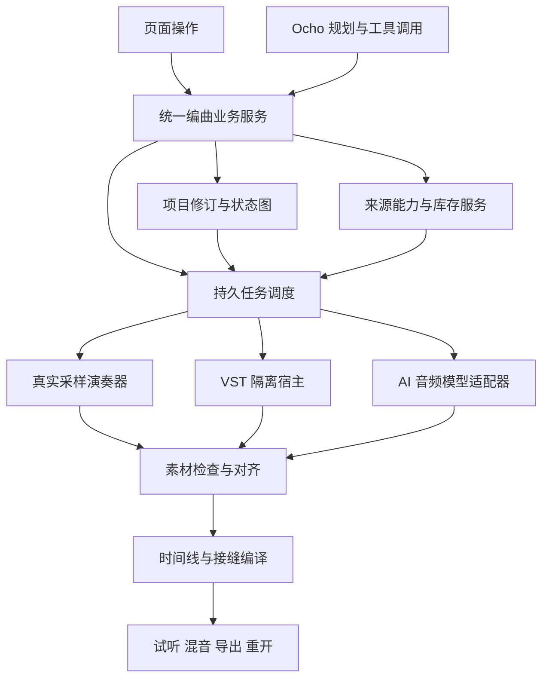

# 智能编曲、音源库与 Ocho 未来迭代规划

日期：2026-10-20。配套：[深度分析及问题报告](./intelligent_arrangement_deep_audit_20261020_zh.md)。

本文中“拟新增”均为规划，不表示当前安装版已经具备。阶段按验收推进，不把工期估计或按钮完成率当作交付承诺。

## 1. 产品目标与完成定义

用户输入一段创作要求、参考材料与来源偏好，系统能利用已有音源、受控获取的新素材、AI 生成和已验证的插件预设完成整曲。用户可以逐句修改、替换来源、试听、编辑和导出，再打开工程继续工作。

**完成一次制作至少需要同时满足：**

1. 实际来源符合真实/AI/混合限制，已下载健康资源优先。
2. 整曲时长、乐器、独奏位置和必要奏法符合需求。
3. 乐谱可看、可编辑，音频与谱之间有明确的适配关系。
4. 每段素材有效长度、起音与落点可验证，不能用大幅截取掩盖失配。
5. 持续声部、尾音和接缝经过检查，听感自然度有分轨对比依据。
6. 模型、插件、原始素材、人工修改和导出结果可追溯。
7. 失败能局部恢复，旧作品和原有功能不受破坏。

不要求初版变成完整专业 DAW；先把“能稳定做成一首”和“知道为什么失败”做实。

## 2. 设计原则

- 前端和 Ocho 调用同一业务服务；两边不能各自实现一套编曲。
- 大模型给出音乐意图与可审核选择，服务端掌管 ID、路径、权限、时基、任务和验收。
- 原始文件不可变；裁切、对齐和混音用可撤销的派生配置。
- 自动化必须基于能力声明和实际结果，不能根据模型名字推断能力。
- 未通过检查的素材进入待处理区，不自动冒充可用音源。
- 人工修改有保护范围，后台结果必须携带输入修订，过时结果留作历史。
- 优先复用现有可靠模块；普通语音、故事、音乐与 SF2 编曲入口保持原语义。

## 3. 推荐的整体架构



保持现有 Go 分层：传输层只做请求与事件；workbench 编排业务；schema 定义合同；score/audio/plugin 等执行具体演奏。Windows 宿主继续负责窗口、文件对话框和原生编辑器，不接管音乐逻辑。

## 4. 最应先补齐的六项数据合同

### 4.1 ProjectRevision：项目修订

拟记录：需求修订、计划修订、曲谱修订、素材适配修订、混音修订，以及它们的依赖关系。采用内容指纹和稳定 ID，不能只靠更新时间判断兼容。

规则示例：

| 修改 | 必须失效 | 可以保留 |
| --- | --- | --- |
| 一个乐句的音符 | 该句跟谱素材、相关演奏与拼合结果 | 无关乐句原始素材、其他轨手工编辑 |
| 整曲速度 | 所有依赖音乐时间的适配与渲染 | 原始生成文件、音源库 |
| 某句来源绑定 | 该句演奏与拼合结果 | 原曲谱及其他乐器 |
| 轨道音量/声像 | 混音与最终输出 | 已验收乐句音频 |
| 输入要求 | 标记计划待同步 | 旧计划及其全部历史成果 |

页面应说清楚“哪项待更新”，而不是所有内容一律显示“已保存/可拼合”。

### 4.2 InstrumentInstance：跨句演奏实例

同一位琵琶演奏者可跨多个乐句持续存在；句内 PartID 仍独立。实例保存音源/插件预设、奏法映射、音量声像和连续性策略。

同一实例相邻乐句优先整轨演奏，保留包络、控制器和释放状态。主动换乐器、换奏法或换演奏者则生成明确的切换事件。

### 4.3 SourceCapability：来源能力

来源属性与实现路径分开：

| 维度 | 示例 |
| --- | --- |
| provenance：声音出处 | 真实录音、AI 生成、合成模拟、混合、未知 |
| backend：执行方式 | WAV 映射、SFZ/采样器、VST3、AI 乐句、用户演奏 |
| musical form：素材形态 | 单音、持续音、完整乐句、循环、效果、整曲 |
| pitch/velocity | 实际覆盖范围、力度层、移调上限 |
| articulation | 挑弹、轮指、滑音、连奏、长音、释放等可验证映射 |
| continuity | 循环区、释放采样、legato、跨句控制状态 |
| readiness | 候选、未下载、校验中、待审核、可用、损坏、过时 |
| licence | 来源页、许可标识、限制、用户提供/购买凭证引用 |

“仅真实”检查 provenance，不因使用 VST 就判定为真实；AI 乐句不能冒充真人演奏录音。

### 4.4 MaterialContract：素材交付合同

每个备料任务至少包含：

```json
{
  "partId": "服务端分配",
  "instrumentInstanceId": "跨句演奏实例",
  "projectRevision": "输入修订",
  "taskKind": "instrument_phrase",
  "musicalStartTick": 0,
  "musicalLengthTicks": 5760,
  "targetCoreFrames": 432000,
  "sampleRate": 48000,
  "targetDurationSeconds": 9,
  "tailPolicy": "preserve_separately",
  "alignmentPolicy": "score_events",
  "sourcePolicy": "ai",
  "requiredArticulations": ["sustain"],
  "modelCapabilityVersion": "实际适配器版本"
}
```

这个 9 秒例子对应 48 kHz 的 432000 帧；tick 长度仅作示意，实际按项目 PPQ 与拍号计算，不能将示例值直接硬编码。

### 4.5 MaterialRealization：生成结果与非破坏适配

结果保存原始文件哈希、实际时长、采样率、检测起音、可用区段、内容检查、对齐置信度、噪声/削波情况；另存裁切、偏移、有限伸缩与尾音策略。

区分四种事实：文件生成完成、通过技术检查、通过音乐适配、用户试听通过。重试只改变相关结果；原文件和上一版仍保留。

### 4.6 RenderManifest：渲染清单

记录输入修订、曲谱、来源、插件预设指纹、生成模型、适配版本、时间基准、接缝策略和导出设置。重开后能准确知道当前声音来自哪里。

清单不能只记文件名；也不能把私密账号、密钥和完整登录 Cookie 打包进工程。

## 5. AI 指定时长：具体怎么做

### 5.1 界面

智能编曲的每个 AI 声部增加二级“生成设置”：

- 长度：跟随本句/指定小节/指定秒数。
- 显示“音乐有效长度”“模型请求长度”“保留尾音”三个值。
- 模型能力说明：是否接收旋律谱、是否支持时长、是否支持续写/参考上下文。
- 预估资源与生成次数；原始/适配后双试听。
- 不支持的组合给出替代方案，而不是把参数静默忽略。

默认跟随本句，用户无需重复输入。按秒数设置时，显示其与小节网格的关系；不在边界的结束位置需要明确的自由尾奏或裁切策略。

### 5.2 适配器

拟新增能力描述：`minDuration`、`maxDuration`、`durationGranularity`、`scoreConditioning`、`isolatedInstrumentReliability`、`vocalMode`、`continuation`、`seedControl`。

由当前引擎、模型版本和实测共同决定，不从上游宣传页面照抄。能力描述进入缓存指纹；适配规则变化时旧素材不会被错误复用。

### 5.3 ACE-Step 路径

在当前适配器支持范围内请求时长。目标短于模型最短请求长度时，明示会生成稍长原片，再选取有效乐句；不能将“最短 10 秒”理解为不能交付 9 秒成品，但成品必须验证内容完整。

把实际调性、拍号映射成模型支持的参数；无法映射时明确标记。自由音频必须显示不能保证逐音符跟谱。

### 5.4 YuE2 路径

先验证 ABC 的小节数、时值、速度、声部与任务一致，再确认引擎实际接收的选项。对当前 9→171 秒案例保留请求、ABC 摘要、引擎版本与返回长度，建立真实模型回归。

本次补查已确认可优先接入引擎已有的语义帧上下限，而不必先假定模型完全无法约束时长：v0.9.1 语义流按每秒 25 帧计，9 秒核心对应约 225 帧。应先在服务端通过受校验的专用长度合同设置范围，并包含模型/引擎版本；默认不改普通歌曲的长度规则。若以后也开放高级选项，必须保持 min≤max，并把数值纳入参数白名单和缓存指纹。

接入顺序：生成长度合同 → 验证帧预算与前缀计算 → 构建引擎请求 → 检查实际音频时长 → 保留尾音并适配 → 试听验收。限制 token 只证明长度预算，不能将截断的乐句当成完整乐句。应验证短于默认最小值、9 秒、较长乐句和带续写前缀等情况，再宣称指定长度可用。

调性同步修复：将明确等价的 `D minor` / `D 小调` 等别名转成 ABC `Dm`，记录原始声明；未知调式显式提示，不能静默回退 `K:C`。音符回读与调性上下文分别验收。

如果模型仍生成完整发展段，状态应是“素材待适配/模型不适合该任务”；可选择其他模型、连续较长声部生成后抽取有效段，或改用真实/VST 演奏。不能单凭“有 ABC”放行。

### 5.5 合唱与器乐分开

- 器乐任务允许 `no vocals`。
- 无词合唱采用无歌词的人声任务，明确元音、织体、人数/合唱感与发声方式，不设置相互矛盾的纯器乐参数。
- 人声样本仍属于智能编曲中的音乐素材；不混进原版人物声音库，避免影响语音克隆流程。

### 5.6 验收

给定 9 秒需求，生成 171 秒时不能直接显示“可拼合”。适配后有效区段必须覆盖所需音乐事件，记录偏移与尾音；若需要极端压缩才能覆盖，拒绝自动适配并建议重生成。

阈值应由素材类型决定。打击起音与气息缓入声部不能共用严格阈值；任何自动校正都保留原版、解释和撤销。

## 6. 解决顿挫的演奏与接缝方案

### 6.1 先统一时间基准

以音乐 tick 保存编辑意图，由 TempoMap 唯一转换为采样帧。生成请求、MIDI、采样演奏、VST 和时间线落点共用这一转换。

固定速度、段落变速、弱起、附点与不同拍号分别验收；禁止不同模块各自用 `小节数 × 固定速度` 近似计算。

### 6.2 分三类接点

| 类型 | 策略 |
| --- | --- |
| 同一连续文件、连续源偏移 | 保持连续或合并排程，不重复淡化 |
| 不同文件、同一音乐声部 | 根据对齐点与可用尾音建立重叠、选择淡化曲线并检查相位 |
| 有意换句/呼吸/断奏 | 保留音乐留白，保护前句自然尾音，不盲目填满空隙 |

不同素材是否适合等功率交叉淡化要具体判断；高度相关信号盲目叠加可能变响或抵消。淡化不能修复错拍、错和声和错误乐器。

### 6.3 真实采样演奏

为持续类采样补足循环点、释放、legato 和奏法能力。没有这些能力时，应显示短音适用范围，不能让一个短音样本被当成无限长的箫或弦乐。

对当前小提琴的 18、24、42 秒位置，先比较源音频包络和谱面连续音，再测试连奏策略；这些接点的时间线与源偏移已连续，不能把“给所有切片做淡化”当作根因修复。人体节奏模拟应对同一演奏者使用连续时序约束，防止每音独立随机位移制造非预期分离，同时保留有意呼吸和断奏。

移调仍保留默认 7 个半音上限。补采样、改配器或局部改谱是明确的修复手段；放大移调范围会带来更重失真。

琵琶轮指至少区分：真实轮指采样、具备轮指奏法的插件、用挑弹重复模拟。第三种应如实标记，并有连续力度/速度变化，不能宣称等同真实轮指。

### 6.4 VST 整轨

同一实例按完整 MIDI 渲染，保留 note-off、CC、延音和预设状态；需要的 keyswitch 与控制器由经过验证的映射配置提供。

三个入口继续区分：宿主测试、当前预设试听、整轨演奏。只有最后一种能证明当前音色适配真实编曲。

### 6.5 AI 连续性

优先生成具有音乐意义的连续声部或若干相关乐句，在其内部按乐谱映射；若模型支持，将前文音频/和声/节拍作为上下文。缺少续写能力时坦诚限制，不把独立短片段强称为连贯演奏。

上下文音频不应被误当成本句输出；提取核心区段和尾音，并记录生成上下文边界。

### 6.6 预览与导出统一

新增接缝和增益计算必须同时用于浏览器试听、离线导出和后端渲染，采用相同数学定义和测试样本。现有被忽略的旧 fade 字段不直接偷偷启用，以免改变旧作品听感；通过版本化策略迁移新编曲结果。

### 6.7 质量测试

- 常量/正弦等确定性信号：证明无非预期间隙、削波和幅度凹陷。
- 同源连续切片与原音频对比：证明没有重复包络或错误偏移。
- 真实拨弦、箫长音、弦乐连奏和合唱：分轨对比原始、适配和拼合结果。
- 统计起音、间隙、响度跃变、峰值和尾音长度；听感验收仍须保留。
- 人声与伴奏失真分别定位，不用一次统一降噪/EQ 处理所有问题。

## 7. 音源库的长期组织

### 7.1 一级结构保持稳定

“智能编曲”继续位于“音乐生成”和声音库之间；“音源库与乐器”保持独立。插件安装与扫描在设置，原“编曲音色库”不迁移或改名。

音源库一级维持我的音源、CC0 目录、在线检索、其他音源站、AI 音源与模型、乐队组合。AI 分为生成素材与模型入口；后续模型页细分音频模型与 SF2 预览库，避免把 SF2 叫作 AI 模型。

### 7.2 行与详情

列表只显示名称、主要乐器/来源、健康和关键操作。详细许可、采样映射、路径、插件依赖、质量与历史放二级详情，继续复用官方声音库的搜索、票根列表、状态与分组。

音源详情：采样列表逐个试听、拖动、根音/力度/奏法、位置与文件状态；AI 详情：任务、原始/有效长度、模型、修订、有效区段、对齐与试听状态；插件详情：预设、来源类型、依赖和整轨测试结果。

### 7.3 下载与登录

下载按内容哈希去重，临时文件通过校验后登记。已安装但文件丢失显示修复；无候选、网络失败、许可不明、格式不支持分别报错。

网站需要登录时：先展示官方链接和操作说明，用户登录并取得文件后导入；有可靠、获准的官方 API 才做专门集成。搜索只产生候选，不能直接变为“已下载”。

### 7.4 乐队组合

保存实例角色、音源/预设、奏法映射、默认混音和依赖摘要。应用时先检查健康、音域与目标曲谱；缺某一件乐器只处理该部分，不覆盖锁定绑定和用户手工选源。

## 8. Ocho 应如何真正打通

### 8.1 第一步：统一技能与路由

拟新增 `yovoice-arrangement` 技能：说明需求识别、库存优先、来源限制、审核、写谱、备料、质量、拼合、导出与恢复。系统提示、产品技能、工作流技能和工具描述同时更新。

保留 SF2 普通编曲教程，但当用户明确要求真实采样、混合音源或 VST 时，不能沿普通教程直接 `generate_work` 冒充完成智能编曲。

### 8.2 第二步：补齐可调用业务

下表是拟新增/调整的接口；命名为建议，实际实现需遵守现有 RPC/MCP 风格。

| 业务 | 页面接口建议 | Ocho 工具建议 | 关键限制 |
| --- | --- | --- | --- |
| 阶段与修订 | `arrangement.status` | `get_arrangement_status` | 返回实际状态与下一步 |
| 计划修改 | `arrangement.plan.patch` | `edit_arrangement_plan` | 带期望修订、差异预览 |
| 审核 | `arrangement.plan.approve` | `propose_arrangement_approval` | 用户确认指定修订 |
| 来源查询 | `instrument.query` | `query_instrument_sources` | 分类、分页、能力过滤 |
| 在线候选 | `instrument.candidates` | `find_instrument_candidates` | 返回许可和适配证据 |
| 获取候选 | `instrument.acquire` | `prepare_instrument_candidate` | 用户授权范围、下载校验 |
| 素材检查 | `arrangement.material.inspect` | `inspect_arrangement_material` | 事实与置信度，不伪造试听 |
| 素材适配 | `arrangement.material.fit` | `fit_arrangement_material` | 原片不变、可撤销 |
| 局部重做 | 现有 prepare 扩展 | 现有 prepare 扩展 | partId/任务目标、预算与修订 |
| 插件预设 | `plugin.presets.query` | `query_instrument_presets` | 只使用已登记且验证预设 |
| 接缝诊断 | `arrangement.seams.inspect` | `inspect_arrangement_seams` | 定位片段与原因 |
| 导出方案 | `project.export.plan` | `prepare_project_export` | 清单先确认，保存走原生对话框 |

不要把全部本机文件系统作为音源库接口。Ocho 可以联网研究，但入库和工程写入统一走业务层。

### 8.3 第三步：三种自动化等级

1. **辅助模式：** 分步建议，用户审核与点击执行。
2. **监督自动模式：** 用户一次确认明确任务、来源限制、预算和已知素材范围；系统执行获准步骤，重要偏离再请求决定。
3. **受限自动模式：** 只在预先批准的本地资源、模型与已验证预设内完成任务，不能自行放宽真实来源限制。

授权是具有项目、动作、预算、修订和有效期的业务记录。不能把聊天中一句“以后都自动”无限扩展到安装任意插件、付费或删除作品。

### 8.4 第四步：任务恢复与报告

Ocho 发起任务获得 ID 后，应订阅事件或用受控查询等待。对话结束、页面切换或助手进程退出，任务仍由应用管理；恢复后先读状态。

每次回复清楚区分已规划、已写谱、已备料、已验收、已拼合和已导出。错误后报告实际完成项及最小返工范围。禁止将“已发起”说成“已经完成”。

### 8.5 第五步：真实助手验收

建立自然语言用例，分别使用真实配置的语言模型与运行时执行，记录工具调用顺序和可核验结果。假运行时测试继续负责协议回归，真实测试负责验证意图路由与长期可靠性；二者不混计通过率。

## 9. 除编曲之外，Ocho 值得承担什么

| 场景 | 用户表达 | 期望行为 | 需要新增的支撑 |
| --- | --- | --- | --- |
| 故障解释 | “为什么这段没声音” | 读真实错误、定位素材/片段、给出修复候选 | 媒体健康与质量检查 |
| 项目导航 | “打开昨晚那首，只改副歌” | 确认作品、定位段落、限定修改范围 | 稳定结构引用、差异预览 |
| 语音制作 | “这句太急，角色别变” | 改该句适用参数、生成新版本供对比 | 参数能力与片段版本 |
| 故事配音 | “换这两个人的声音，其他别动” | 仅变指定角色/台词 | 角色映射和局部生成 |
| 音乐指导 | “解释为什么这里要用箫” | 引用计划与音域，提供可试听替代 | 方案理由与候选样本 |
| 混音辅助 | “这段太刺，先给我对比” | 分轨检测，生成可撤销候选与 A/B | 音频分析、版本化处理 |
| 库存整理 | “我有哪些能吹长音的民乐” | 按能力列出已下载健康来源 | 能力索引与分页 |
| 资源维护 | “这些文件能删吗” | 列引用与可回收空间，再走确认 | 依赖图与回收站 |
| 导出交付 | “要视频用的 90 秒版本和可编辑工程” | 明确时长/尾音、混音与依赖，准备导出 | 导出清单和目标预设 |
| 创作学习 | “我不懂调性，给我几个适合的” | 解释可选调式并展示/试听候选 | 参数解释与小样接口 |

这些能力应围绕用户作品和可复核操作，不追求把 Ocho 变成能任意操作电脑的通用机器人。

## 10. 分阶段交付

### 阶段 0：界面与可观测性修复（本次）

- 播放实例生命周期、实际文件路径。
- 重复组件标识修复，曲谱面板高度与收起。
- AI 素材/模型分类。
- 官方 Windows 滚动蒙版修复。
- 保留原始作品与采样，备份已安装界面。

门槛：复现用例由失败变通过，真实合唱可播放与拖动，旧作品切换不残留，原有界面回归通过。

### 阶段 1：时间与素材合同（最高优先）

- 实现统一时基、MaterialContract、模型能力适配。
- 修复无词合唱与无 vocals 的任务冲突。
- 超长素材进入待适配，不直接作为正确乐句。
- 原始/适配后 A/B、长度与起音检测、局部重试。

门槛：9 秒案例能解释并修复；每个素材显示有效区间与来源；不支持的模型明确拒绝或转候选；改变一个音符仅使相关条件素材失效。

### 阶段 2：连续演奏与接缝

- 实例 ID、连续真实/VST 渲染、尾音和奏法能力。
- 版本化接缝策略，试听和导出一致。
- 建立真实箫、琵琶、弦乐、AI 合唱的分轨比较。

门槛：同源连续切片无额外凹陷；跨源边界无非预期空白；持续音与呼吸可解释；重开保持编辑与预设。

### 阶段 3：Ocho 业务闭环

- 更新系统提示和技能，完整审阅/执行/等待协议。
- 来源查询、候选获取、素材适配与诊断工具。
- 修订保护、动作预算、失败恢复和状态卡。

门槛：真实模型执行“需求→库存→规划→审核→写谱→备料→验收→拼合”，工具结果与界面一致；无法完成时说明准确卡点，不回退冒充成功。

### 阶段 4：音色库与专业表现扩展

- 乐器分类、持续采样/奏法映射、验证预设组合。
- 丰富登录来源与用户文件导入，保留许可与依赖。
- 乐队模板复用、音乐分析与混音候选。

门槛：资源增加不降低匹配准确率；仅真实模式保持来源约束；每种关键奏法至少有实听样本与自动结构检查。

## 11. 验收矩阵

| 类别 | 必须通过的场景 |
| --- | --- |
| 实际故障 | 合唱在列表/详情/搜索切换后可播；新建空工程无旧轨道 |
| 时长 | 3/9/30 秒等不同目标、模型最短长度、明显超长、过短、尾音策略 |
| 时间 | 80 BPM 固定速、段落变速、3/4 与 6/8、弱起和句内休止 |
| 真实采样 | 已下载不联网、文件缺失、错误乐器、音域/力度/奏法不足、移调保护 |
| AI | YuE2 条件实际接收、ACE-Step 受支持参数、自由音频标记、内容/时长不符 |
| 混合 | 真实/AI 同时与交替进入，局部变更只返工相关素材 |
| VST | 真实预设整轨、控制器和尾音、依赖缺失、插件崩溃隔离、重开预设 |
| 接缝 | 同源连续、不同来源、打击起音、长音释放、有意休止、预览/导出一致 |
| 持久化 | 第四句失败保留前三句、重启恢复、撤销、后台过时结果不覆盖 |
| Ocho | 正确工具路由、审核等待、搜索仅候选、真实模式不混入未知来源 |
| 工程 | 合法素材打包、外部依赖清单、换目录与另一空环境重开 |
| 兼容 | 语音、故事、音乐、普通 SF2、声音库与设置完整回归 |

真实模型与 VST 用例不能用测试音、假成功响应和假运行时替代；自动化报告必须记录哪些真实用例因环境或模型缺失未执行。

## 12. 发布与迁移

- 保留一个安装版本，前端纯修复可通过静态界面更新交付，保留备份与文件校验。
- 涉及后台、模型适配和数据库的版本，先备份安装与一致性数据，再通过追加迁移升级。
- 不批量重写旧曲谱、绑定或音频；旧素材按旧适配版本保留，新策略生成新结果。
- 每次发布记录官方基座、定制提交/构建、数据库、引擎、模型适配及插件宿主版本。
- 官方更新先看兼容性；v0.3.1 的 UI 热修复可以独立吸收，不应覆盖定制业务和用户配置。
- 回滚区分界面回滚、程序回滚与数据回滚，数据库升级后不能简单安装旧程序当作安全回退。

## 13. 最终建议

下一轮先把“9 秒乐句”做成一个准确、可解释、可撤销的完整交付单位，再解决连续演奏和接缝。随后让 Ocho 使用同一合同与状态图完成任务。

衡量迭代的重点应是：用户提出要求后，系统能否用真实可用的资源做出符合长度、配器、奏法和衔接要求的作品；遇到限制时，能否准确指出哪一句、哪件乐器、哪种能力不满足，并只返工必要部分。
