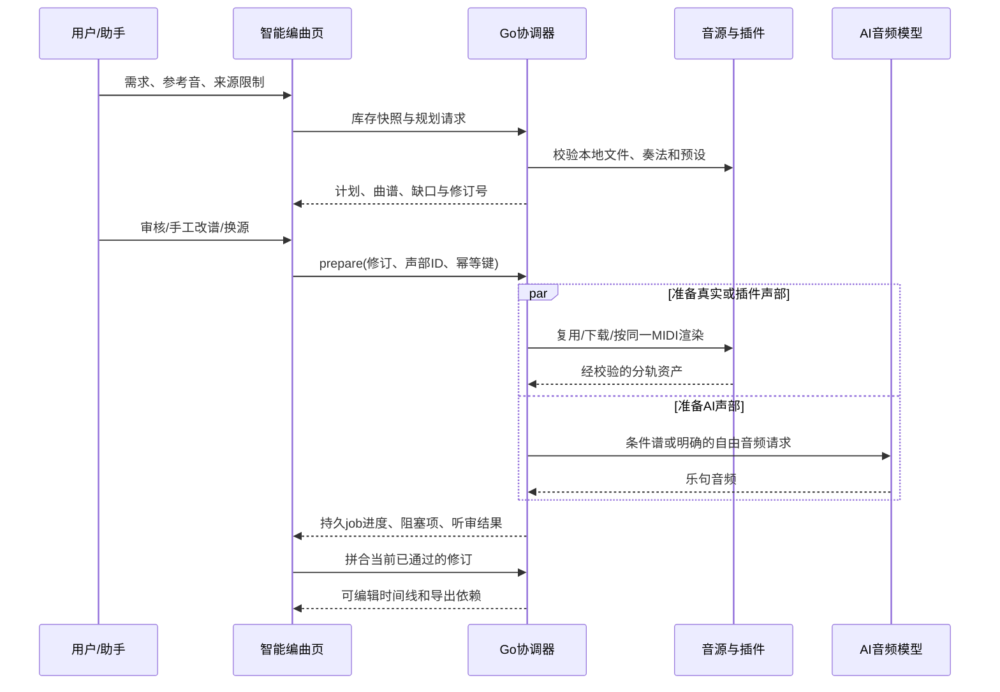

> 2026-10-20 实施更新：本文件保留研究 / 规划基线；已落地内容、实际测试证据和未验收项见 [实施与验收记录](intelligent_arrangement_implementation_20261020.md)。

# yovoice 智能编曲 PRD（v1 草案，2026-10-19）

## 1. 产品定义

**产品目标**：把一句自然语言需求变成“可审、可听、可修、可追溯”的多轨器乐编曲工程。系统使用本地真实采样、VST 和 AI 生成素材中的任意一种或组合；AI 负责提出方案与协调任务，关键乐器身份、来源和最终音频由确定性校验约束。首批重点是中国民俗民乐，但数据模型不依赖某一种曲风。

**首个验收用例**：90 秒中国民俗配乐，以琵琶、箫为主，含独奏和轮指、挑弹，自然节奏，能指定仅真实音源或混合来源；已下载合格音源直接复用，缺真实箫时提示并可替换；一键备料后整轨拼合，保留曲谱、音频轨与可编辑工程。

**非目标（本版）**：保证模型生成任意文字提示都具有精确 MIDI 演奏；无授权自动爬取所有音源站；自动安装厂商带账户登录的软件；声乐修音。通用声乐、人声质感属于独立后续工作流。

## 2. 用户、场景与成功标准

| 用户任务 | 关键交互 | 成功标准 |
| --- | --- | --- |
| 不懂乐理但知道想要的氛围 | 用中文描述时长、乐器、奏法、情绪，调性可选也可输入 | 出现能逐句审阅的结构和预览，不要求先懂 MIDI。 |
| 只要真实采样 | 选“仅真实”，系统盘点本机资源 | 未经允许绝不转成 AI/模拟音色；缺口定位到具体句、奏法和音域。 |
| 已有音源想直接用 | 在声部行选择“库中已下载”或手动替代 | 无重复下载；替代前后保留乐谱乐器名，试听和来源清晰。 |
| 想用民乐 VST | 在设置扫描插件与音色包，在声部绑定预设 | 可打开插件原生编辑器，可保存状态、重开一致，能离线渲染整轨。 |
| 想让 Ocho 自动推进 | 在助手中说任务，审阅计划，批准备料 | 助手能盘点、规划、启动并追踪任务；需要登录/许可/人工试听时准确停下。 |
| 想精修并重导 | 调音符、声源、入点、淡化和声像 | 局部改动只让相关素材失效，手工轨道和历史版本不丢。 |

北极星指标：从输入到“可播放且可编辑时间线”的完成率；细分监测计划通过率、源匹配率、备料成功率、拼合通过率、导出再打开通过率。首个公开预览发布门槛：固定验收用例在干净配置和用户数据副本各连续通过 3 次；不得用静音或测试音代替真实音色。

## 3. 菜单、页面与统一设计

左侧主导航次序：语音生成、故事配音、音乐生成、**智能编曲**、声音库、**音源库与乐器**。官方普通“编曲生成”仍是“音乐生成”的二级页。设置保留官方“编曲音色库”（SF2/模型）；另有“插件管理”，模型下载仍在官方模型设置。音源库沿用声音库的页眉、页签、搜索、列表、详情式交互。

智能编曲页面使用原版 Astryx 容器和 token：顶部显示当前作品与状态，下面依次是需求、整曲结构、声部表、素材准备、曲谱/时间线、导出；内容区域必须在窄高窗口可滚到底部，滚动位置在切换二级页后保持。每一阶段要有主操作和清晰的下一步，但“生成”和“下载”不混用同一词。

音源库二级页：**我的音源**、**CC0 目录**、**在线候选**、**其他网站**、**AI 生成素材**、**乐队组合**。搜索跨当前页字段，支持乐器名/别名、奏法、来源、许可、是否已下载。详情中每个采样单独播放、暂停、拖动进度；下载显示已收/总字节、速度、失败原因和重试；原站需要登录时跳官方页面后手动导入，不索取账户凭证。

## 4. 关键流程与状态

1. **新建**：输入文字、时长（15–600 秒）、来源策略（自动/仅真实/仅 AI/混合）、必选/排除乐器、指定独奏和奏法、可选参考音频及音源组合。保存为 `briefRevision`。
2. **盘点**：扫描本地数据库与真实文件，生成库存快照；标记 `ready`, `candidate`, `missing`, `corrupt`, `license_review`, `login_required`, `plugin_missing`。优先匹配已下载源，匹配分数解释原因。
3. **规划**：AI 按库存快照给出段落、乐句、固定 ID、乐器、角色、奏法、来源策略、目标调/拍/速度和置信度。服务端拒绝漏段、重叠、违反仅真实/仅 AI、与必选乐器冲突的计划。用户可增删和固定乐器；改动生成新 `planRevision`。
4. **写谱**：先建立含固定 `partId` 的空轨，再按乐句填音符。每个计划乐句至少一条非静音的对应音符轨；音符必须在乐句时间范围内。失败显示乐句级原因和“局部重试/手动编辑”。曲谱使用五线谱/轨道，支持 MIDI 与有限 ABC 导入；丢失来源信息的导入须提示重新绑定。
5. **备料**：按选中声部单个下载/生成，或“准备全部真实源”“生成全部 AI 乐句”“一键准备”。任务可取消、失败单项重试、重启续跑；完成后素材进入音源库，带真实/AI/VST、模型或插件、许可、日期、校验值和工程引用。
6. **拼合**：运行预检；通过后采样/VST 按 MIDI 渲染，AI 音频按乐句放置与对齐。用户可试听分轨、锁轨、替换、调整剪辑边界与淡化，再导出混音/分轨/工程。

计划状态 `draft → validated → approved → stale`；素材任务状态 `queued → running → ready | needs_review | failed | cancelled`；拼合状态 `blocked → ready → rendering → review → exported`。任何编辑只让依赖它的 job 失效，不重置其余声部。关闭窗口或重启服务后状态可恢复。后台进行时 UI 不假装完成。

### 音源选择规则（必须由后端执行）

| 顺序 | 候选 | 可自动绑定的前提 | 失败时显示 |
| --- | --- | --- | --- |
| 1 | 用户在本声部明确绑定的本地采样或预设 | 文件与许可有效，音域和奏法覆盖本声部；重新打开工程能定位同一资产 | “指定音源不可用”，保留绑定并给出替换按钮。 |
| 2 | 已下载的真实采样 | 乐器身份匹配、非模拟、校验值与文件一致、音域及奏法覆盖 | “已下载但不适合此乐句”，列出差的音符或奏法。 |
| 3 | 已安装且有音色包的 VST | 插件扫描、预设恢复与离线渲染预检通过 | “插件已装但音色/预设未就绪”。 |
| 4 | CC0 固定目录及可自动获取的官网素材 | 来源许可、文件和元数据可验证，下载后再进行音域/奏法预检 | “可下载 / 下载失败 / 下载后不合格”分别显示。 |
| 5 | AI 生成或外部网站候选 | 仅在来源政策允许时；AI 声部必须保留模型与提示信息，网站候选须复核许可证 | “需要用户选择或授权”；不能自动偷换乐器。 |

“自动”是按上述规则挑选可用候选，不等于跳过乐器、奏法和来源限制。分数相同优先选择用户此前固定的乐队组合；任何替代音色在声部卡片明确标识“原定乐器 → 实际声源”。

## 5. 数据契约

`ArrangementDocument` 是持久主对象，至少包含 `id, projectId, briefRevision, planRevision, durationFrames, sampleRate, tempoMap, meterMap, key, sections[], parts[], tracks[], jobs[], timelineRevision`。`section`/`phrase`/`part`/`track` 均有稳定 ID；人类名称是可变标签。`part` 记录 `instrumentCanonical`, `displayName`, `role`, `techniques[]`, `sourcePolicy`, `boundSourceId`, `locked`, `required`, `startFrame`, `endFrame`。`track` 引用 `partId` 和音符，不允许靠名称或 `role` 推断唯一关系。

`SourceAsset` 记录 `id, kind(real|ai|vst_render), instrumentCanonical, articulations[], playableRange, velocityLayers, fileHashes[], licenseId, licenseURL, sourceURL, creator, verification, downloadState, localPathRef, modelId, pluginId, presetRef`。`localPathRef` 只能经应用媒体目录解析，不暴露任意绝对路径给 Web 前端。VST 二进制不放入工程包，工程包存插件标识和预设状态、依赖清单；缺插件可重定位或替换。AI 乐句另存 `prompt, seed, modelVersion, targetPhraseId, targetFrames, resultFrames, qualityFindings[]`。

向旧 `Draft.Score` / `Draft.Timeline` 做兼容映射，不改官方已能使用的字段语义；数据库迁移只追加版本与新表/字段，重复运行幂等。导入旧预览计划时先生成稳定 ID，保留原计划和素材的备份；不能自动猜出无证据的音源绑定。

## 6. 后端能力与接口（建议契约）

| API/工具 | 输入 | 输出/规则 |
| --- | --- | --- |
| `arrangement.inventory` | `projectId`, 可选 `refresh` | 带文件验证时间和候选能力的库存快照；不执行下载。 |
| `arrangement.plan` | `briefRevision`, `inventoryRevision`, 来源约束 | `planRevision`、乐句声部、缺口报告；模型建议经过服务端验证。 |
| `arrangement.validate` | `planRevision`, `scoreRevision` | 每个 `partId` 的 `ready/blocked` 与结构化错误码；无副作用。 |
| `arrangement.bindSource` | `partId`, `sourceId`, `expectedRevision` | 校验类型、许可、文件、音域、奏法；冲突返回新状态供用户确认。 |
| `arrangement.findCandidates` | `instrument`, `techniques`, `licensePolicy` | 候选及证据 URL；不自动把网页标题当真实可用音色。 |
| `arrangement.prepare` | `partIds[]`, `mode`, `expectedRevision`, `idempotencyKey` | 返回 job IDs，推送真实进度；同输入重复调用复用任务。 |
| `arrangement.render` | `projectId`, `planRevision`, `scoreRevision`, `sourceRevision` | 先预检，再返回 job；不覆盖手工轨道。 |
| `arrangement.jobs` | job IDs | 阶段、进度、失败码、可用行动。 |
| `arrangement.export` | 混音/分轨/工程选择 | 文件及依赖清单；缺素材拒绝“成功”结果。 |

错误码要能直接驱动 UI，例如 `SOURCE_FILE_MISSING`、`SOURCE_SIMULATED_NOT_REAL`、`ARTICULATION_UNAVAILABLE`、`PITCH_OUT_OF_RANGE`、`PLAN_SCORE_UNCOVERED`、`AI_STEM_TOO_SHORT`、`AI_STEM_OFF_BEAT`、`PLUGIN_PRESET_MISSING`、`LICENSE_REVIEW_REQUIRED`、`LOGIN_REQUIRED`、`DB_MIGRATION_INCOMPATIBLE`。每条错误带 `partId/phraseId`、用户可读解释及允许的修复操作。下载层另分 DNS、代理、HTTP、校验、转码错误；不一律显示“音源缺失”。

## 7. Ocho 集成要求

Ocho 使用官方现有会话和工具事件框架，新增领域 MCP 工具映射到上述后端接口。助手可读库存、查看计划、提议替换、启动已授权的备料与渲染，并报告 job 的真实状态。网页版搜索只产出候选；跨站登录、非明确许可、购买、执行插件/安装器需转成用户操作。正式音源导入使用受限后端接口，不能让通用 shell 直接写 `~/.yovoice` 数据目录。

助手上下文增加当前 `projectId/planRevision/selectedPartId/selectedPhraseId/activeJobIds`。与普通聊天分离的工具卡片显示“建议”“运行中”“成功”“失败/待用户处理”。模型可能回答错误，因此产品状态以工具结果和应用数据库为准。Ocho 与专门的在线规划模型可以共用 DeepSeek API 服务配置，但职责不同：前者是交互协调器，后者输出受 schema 约束的计划/音符；`ChatGPT (Codex)` 普通 AI 服务不可自动当成 Ocho 运行时。

## 8. 音频与音乐质量要求

- 时间基准使用 44.1 kHz 或实际项目采样率的整数帧；段落边界到音频剪辑偏差不超过 10 ms。对自由文本 AI 音频，若无法满足，不标为“精确同步”，提供手动对齐。
- 真实采样逐音符要求音高范围、奏法、力度层可覆盖；不能用相差过大的变调掩盖缺失。琵琶轮指、挑弹至少分别有经听审的真实采样或明确支持的 VST 奏法；否则计划仍可保存但成品不得宣称满足该需求。
- 所有导出无削波；最高峰小于 -1 dBFS，目标响度由用户选择的用途决定。对源切换做短淡化，避免爆音；AI 乐句的底噪、合成器质感与声源泄漏有听审标记。
- 自动质检测时长、静音、削波、节拍偏移、单音音高和错误乐器泄漏；主观“人味”用双盲试听记录，不把单个数值当成证明。

## 9. 兼容、许可、安全与性能

先对官方和预览版本的真实数据库副本做迁移，保留原目录备份；设置里的原编曲音色库及普通生成路径回归通过后才允许覆盖安装。工程导出只包含实际引用且可分发的资产；来源许可证和署名要求在工程清单可见，CC0 与“免费但限非商用/需登录”不得合并。源站使用官方 API/下载地址与许可证据，不绕过登录。插件只在隔离进程加载；崩溃必须隔离到该声部，主服务和作品仍可打开。大型源下载流式写入临时文件，校验后原子入库；同源相同哈希去重。网络或模型任务失败后可从完成阶段恢复。

## 10. 验收用例与发布判定

1. **真实源复用**：已安装笛子/二胡/古筝，计划选竹笛/二胡/古筝；库存显示已下载，准备全部真实源不得发网络请求；每个声部最终来源 ID 与时间线资产一致。
2. **缺真实箫**：只有模拟箫时，仅真实计划准确报 `SOURCE_SIMULATED_NOT_REAL`；允许手动真实源、VST 或更改来源策略，任何路径都不静默偷换。
3. **计划曲谱一致**：对“江湖夜雨十年灯”和“未寄出的告白”的复制工程运行校验，逐乐句有声部、有音符；若无法自动修复，用户看到具体缺失句及可编辑位置。
4. **混合来源**：一条真实琵琶与一条 AI 氛围声部在不同乐句出现，AI 音频生成入库，拼合后两条可单独静音/移动/替换；重新打开工程位置不变。
5. **VST**：扫描插件、手动安装、打开操作台、载入明确音色、保存状态、重启、整轨渲染和工程缺插件提示完整走通。单音测试音不算验收。
6. **异常**：断网、失效代理、哈希不符、源站需登录、样本缺失、模型未安装、插件崩溃、任务取消、重启恢复都有可定位状态，已完成工作不丢。
7. **官方回归**：普通语音、故事、音乐、编曲生成、声音库、Ocho、YuE2 ABC、设置、导出仍能使用；全量自动回归和 Windows 安装版手工矩阵通过。

发布结论采用三档：`实验性（仅规划/备料）`、`预览（端到端但有明确限制）`、`可用（上述场景及回归均通过）`。当前智能编曲仍处于实验性阶段；安装版 `0.3.1-preview.1` 已覆盖原有唯一安装并成功读取 v4 库。新规划已有稳定层级 ID 与曲谱轨道 partIds 绑定，无歧义旧工程在保存时自动迁移；有歧义或缺音符的旧工程保留原状。逐乐句写谱、真实素材质量、VST 整轨和安装版整曲验收仍未完成，不能据启动与代码测试宣称工作流“可用”。本 PRD 描述目标要求，不是当前功能全部完成的清单。

## 11. 页面行为、手工介入和样式约束

需求区应始终允许编辑新需求，示例仅作为可替换文本；切换作品后展示该作品自己的需求、来源策略和进度。提供调性可搜索选择框与自由输入，常用大/小调和五声调式有中文说明；更改调性标签不等于自动转调，需独立的“转调曲谱”动作及音域预检。

参考音频与演奏音源使用不同入口：参考音用于提取速度、调性、段落和风格建议，未经用户选择不得直接作为成品素材；用户上传演奏音源时，选择单音采样、多采样乐器或完整音频片段，登记根音、奏法和来源。长乐句不能冒充覆盖全音域的单音乐器。用户可选择把个人音源加入全局库，或仅随当前工程保存。

方案声部行默认只显示乐器、角色、来源、绑定音源、就绪状态和单项操作；展开后显示音域、奏法、可用文件及诊断。来源选择、手动替换和固定乐队组合在当前页完成。批量操作共用单项任务，用户连续点击不会重复启动下载或生成。“固定为乐队”保存 canonical 乐器、奏法、源 ID/预设与策略，不保存临时下载进度；套用到新曲时重新核对文件和音域。

所有预览播放器必须区分“一个采样”“当前预设”“整个声部”“整曲混音”，显示时长、进度、播放/暂停与可拖动位置。尚未下载的条目只有存在合法预览文件时才允许在线试听；否则明确提示下载后试听。音源库每个采样均可独立播放，切换采样停止前一个，失败指向对应文件。下载进度与生成进度分别按实际字节和已完成乐句展示。

视觉沿用官方声音库及 Astryx 设计系统：页眉、工具栏、搜索、列表行、展开详情与空态复用组件和 token；状态用状态组件，数量用计数标识。详情与任务不堆在一级导航；插件仍归设置，AI 模型分类入口跳官方模型下载页。滚动容器只在内容区设置，底部按钮不能压住最后一行，键盘焦点和窄窗口可用性纳入回归。

| 用户所处状态 | 行主操作 | 展开操作 | 继续条件 |
| --- | --- | --- | --- |
| 本地已下载且满足当前声部 | 试听 / 使用 | 查看采样、替换、固定 | 文件、奏法与音域全部满足。 |
| 有记录但文件缺失或不完整 | 修复下载 | 重新定位、手工替换 | 文件校验恢复；不显示“已就绪”。 |
| 固定目录可下载 | 下载 | 来源/许可、样本信息 | 下载与能力检查完成。 |
| 仅官网手动获取或需登录 | 打开官网 | 导入采样/选择插件预设 | 用户正常登录获取后导入，不把网页链接当音源。 |
| AI 乐句未生成/已失效 | 生成 / 重新生成 | 模型能力、提示和音符条件 | 当前修订的素材质检通过或用户完成听审。 |
| VST 已安装但没有音色包 | 选择音色 / 编辑音色 | 宿主测试、路径和版本 | 当前预设及音色包可恢复并输出音频。 |
| 缺少要求的乐器或奏法 | 更换音源 | 保留计划、导入、允许替代 | 用户显式调整约束或补齐资源。 |

## 12. 实现契约补充：版本、缓存、任务和资源

来源类型必须拆开：`provenance=recorded|ai|synthesized`、`renderer=sampler|vst|audio_clip`、`acquisition=installed|catalog|website|imported`。`仅真实`检查 provenance 和用户允许的替代范围；不能因为插件用真实软件运行，就把合成模拟箫当作真人箫录音。插件支持 VST3 不等于兼容旧 VST2、32 位或所有厂商格式；不支持的格式应在导入前说明，不进入无限重试。

每个后端 job 至少保存 `jobId, projectId, partId, phraseId, expectedRevisions, dependencyIds, state, progress, attempt, outputs, error`。输入快照冻结，完成时用 compare-and-swap 提交：若用户期间改了该声部，结果保留为旧修订素材，不覆盖新计划。每个乐句成功后单独登记，取消和后续失败不能删去此前已经完成的合法成果。全局并发数和模型运行资源由后端调度，页面重新挂载只订阅已有 job。

缓存键包含模型 ID/版本、提示模板版本、奏法、时长、调速与来源约束；`score_conditioned` 还必须包含本句音符、控制器、速度图及条件编码版本。修改一个音符只使相关条件素材失效。`free_audio` 可复用，但必须显示“自由音频，未保证跟随修改后的谱”，由对齐检查和用户听审决定是否继续。stable partId 是身份，数组索引仅用于显示位置，不能成为素材长期主键。

可编辑工程包包含计划修订、曲谱、时间线、实际使用的合法媒体、AI 生成参数、插件预设和依赖清单。插件二进制及许可不允许再分发的音色不随包复制；该声部可带获准的冻结音频，并显示重编辑所需依赖。未拼合但已备好的素材同样有工程引用，资源清理要统计引用后再处理。全局乐队预设与项目依赖分开存储，导入工程不覆盖同名全局音源。

## 13. 端到端时序与追加验收

补充以下验收，全部使用副本工程或专用验收工程，不能改坏用户正在编辑的作品：

| 编号 | 场景 | 必须能观察到的结果 |
| --- | --- | --- |
| A08 | 批量 AI 第四句失败 | 前三句可在素材库试听，重试仅跑第四句及未完成部分。 |
| A09 | 只修改第三句一个音符 | 第三句条件 AI 音频失效；无关真实素材和其他句不重新下载/生成。 |
| A10 | 同名乐器两个声部、交换乐句顺序 | 仍按 stable ID 绑定，不靠数组位置误用对方素材。 |
| A11 | 参考音与手动导入音源同时存在 | 风格分析引用与实际演奏资产分开显示，能手动更改绑定。 |
| A12 | 保存为乐队、换一首需求后套用 | 复用音色与预设，重新验证音域、奏法与可用文件，不复制旧歌曲旋律。 |
| A13 | 旧 v4 数据与官方更新覆盖 | 升级前保留程序和数据库备份；拒绝不兼容版本；同一安装可恢复启动。 |
| A14 | 极短窗口及键盘操作 | 所有阶段可滚动到最后操作；搜索、详情、播放器和按钮有可见焦点。 |
| A15 | Decent Sampler 宿主测试成功但无民乐预设 | 只显示宿主可用，真实音色/整轨状态仍未就绪。 |

## 14. 交付物与实施状态索引

现状证据、严重性和 Ocho 架构判断见[问题分析报告](intelligent_arrangement_analysis_zh.md)；依赖顺序、工作包与退出条件见[迭代规划报告](intelligent_arrangement_roadmap_zh.md)。这三份文档共同完成本次研究交付。M0 中的代码整合、数据库兼容和唯一安装启动已经有证据；任务图、模型条件适配、VST 整轨和完整民乐成品仍为下一步迭代，不应标为已完成。
