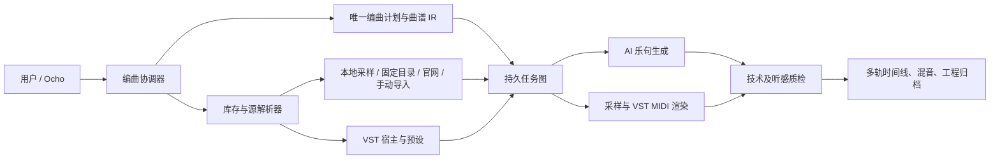

> 2026-10-20 实施更新：本文件保留研究 / 规划基线；已落地内容、实际测试证据和未验收项见 [实施与验收记录](intelligent_arrangement_implementation_20261020.md)。

# 智能编曲整合与迭代规划（2026-10-19）

## 目标和边界

目标体验：用户说“90 秒中国民俗配乐，琵琶和箫为主，有琵琶独奏、轮指与挑弹，节奏自然，保留工程”，系统先盘点已安装音源并展示缺口，再产出可审查的逐乐句配器与曲谱，分别准备真实/VST/AI 声部，统一时间码拼合，最终可手工编辑与导出。来源模式可以是仅真实、仅 AI 或混合；任何缺源都显式停在可修复状态，不偷换成不相干乐器。官方普通音乐生成、编曲生成、声音库和设置保持原有行为。

本规划面向官方 v0.3.0 基座；不把现有智能编曲预览页面的按钮数量视作完成度。核心验收是用户的真实项目能从输入走到可播放、可编辑、可重新打开的成品。

**截至本文的实施状态**：官方 v0.3.0 与预览功能已完成代码整合，并于 2026-10-19 覆盖安装为本地定制版 `0.3.1-preview.1`，只保留一个登记安装。已补独立导航、原音乐作品的曲谱/音频页签和智能编曲页自动保存；写谱增加基于已批准计划的覆盖校验与一次修复。新计划已有服务端分配的 section/phrase/part ID，曲谱轨道绑定 partIds；无歧义旧工程在保存时迁移，缺音符或有歧义的工程保留原数据并报告原因。安装版已读取原有 20 个作品、11 个音源，392 个采样文件均在，数据库不再阻止启动。逐乐句写谱、真实音源质量、AI 乐句同步、VST 整轨和 90 秒成品仍未完成端到端验收；以下里程碑列出达到目标还需要的工作。

## 建议架构

本轮另修复一处前后端契约断点：拼合前端预检识别已登记的 AI 整句音频，不再仅在单音采样库里寻找它。所选模型、乐句位置和计划哈希必须一致；后端仍验证实际文件。新增声部 ID 与 AI 备料预检回归后，编曲页面 20 项通过；安装版启动已验证，真实模型与整曲质量仍待验收。

**控制面**：Ocho 理解需求、读状态、提出选择与调用领域工具；“哪一个文件可用、何时下载、怎样判定完成”由确定性 Go 工作流负责。**数据面**：本地采样、VST 宿主、AI 模型只产出带来源和校验信息的音频资产。将网络搜索与许可证判断当成有证据的候选筛选，不把模型写出的 URL/源 ID 当事实。

## 里程碑与依赖

### M0：安全整合与可诊断基线（必须先完成）

1. 合并官方 v0.3.0 与预览代码，保持普通“音乐生成 → 编曲生成”位置；智能编曲、音源库和插件设置分别作为独立入口。每一处冲突按语义处理，不能只让文件编译通过。
2. 为预览数据 `user_version=4` 建立升级与回退演练：先只在数据库副本运行，清点作品、11 个音源、采样 SHA、AI 材料、乐队预设、密钥记录数量；确认后才可安装替换。保留原始备份并记录目标版本。
3. 已将此前浏览器失败按产品回归、官方导航变动与并发超时复核，最近全量 127/127 通过；后续保持此基线，并补 Windows 安装版的真实音频功能矩阵。浏览器通过不能替代实机生成通过。
4. 建立任务诊断页：每个乐句显示计划声部 ID、曲谱声部、源状态、实际文件、阻塞原因和下一步按钮。统一日志关联 `projectId/planRevision/partId/jobId`。

**退出条件**：真实 v4 工程在整合版可打开且不丢原有项目；官方主要入口和 Ocho 正常；失败信息能指到具体乐句而非笼统“下载失败”。

### M1：统一计划、曲谱和音源约束（首要功能修复）

1. 引入稳定 `sectionId/phraseId/partId/trackId`，人类可改乐器名但 ID 不随改名变化。计划、音符、素材和时间线都引用同一 ID。唯一主表示为多轨 `ArrangementDocument`；ABC、MIDI、YuE2 旋律谱是导入导出视图。
2. 规划前做库存快照。每个候选含：原音/模拟/AI/VST 类型、许可、已下载和文件完整性、可奏音域、奏法、力度层、采样时长、插件/预设可用性、来源 URL、可信级别。模型看到的是经过筛选的摘要，服务端再做确定性绑定。
3. “先创建空白声部与小节骨架，再填音符”。按乐句或分组请求模型只填给定 ID 的音符；每批输出做完整覆盖、调性/节拍/音域/奏法校验。局部失败只重试该乐句，不让整曲重新随机规划。AI 模型可建议新增乐器，但要回到源匹配审核。
4. 生成前给出可预检报告：已就绪、可目录下载、仅官网手动获取、缺音色、奏法缺失、音域不符、许可待确认。用户可在当前乐器框替换；显式替换保留原谱面乐器名和奏法说明，标记“替代音色”。

**退出条件**：现有两个失败工程不再因“计划有声部而曲谱没有音符”中断；修改一个乐句不重置无关素材；仅真实模式不出现 AI 声部；库中可用源不触发重复下载。

### M2：三类音源的可恢复备料

- **真实采样**：本地优先；固定 CC0 目录有 SHA/大小校验和镜像策略；网站登录或特殊授权只提供官方入口与手动导入。自动搜索只返回候选，必须有许可证据、原站链接和格式/音高检测。自动抓取失败可替换源、改用 VST、改为 AI 或暂停该声部。
- **AI 乐句**：模型选择是声部级的；使用乐谱 MIDI/ABC 条件的模型优先。文本条件模型只作氛围或可人工确认的自由乐句，不能宣称音符精确。输出分轨做时长、起音、响度、音高/节拍与其他乐器泄漏检测；不合格可重新生成或降级为人工审听。
- **VST**：建立持久的隔离宿主会话，插件 ID、版本、二进制路径、音色包/预设引用、状态快照和轨道参数入工程。插件界面由“编辑音色”按钮打开；渲染时同一预设接收整轨 MIDI 并输出 WAV。缺插件时显示可替换/重新定位，不默默改音色。插件安装不等于有可用音色包。
- **统一任务图**：任务 `queued → running → ready/needs_review/failed/cancelled` 持久化。相同资产哈希复用；重启后恢复；单项、批量、一键全部三种操作共享实现，实时显示字节和乐句进度。

**退出条件**：本机已有笛子/二胡/古筝实际被复用；真实箫不存在时显示明确缺口；AI/VST 各至少有一条真实音频落到素材库并可试听、拖动进度、查看来源。

### M3：拼合、编辑和音质

统一以样本帧为时间基准，乐句有 `startFrame/endFrame`，MIDI 音符经速度图换算。所有素材明确原点、前置空白和裁剪偏移；先对齐，再做短交叉淡化、响度和峰值管理，避免硬接、电音燥感和失真。AI 乐句不合拍时不自动挤压到时长，应给出偏差和处理选择。允许真实/AI/VST 同乐器分句切换，保留三种源的独立轨道与编辑历史。输出混音、分轨、MIDI/ABC、带素材的 `.yovoice` 工程；资源管理识别“已备料未拼合”的资产，避免误删。

**退出条件**：90 秒民乐案例可从保存工程重新打开；对一个声部替换音源并重拼只改变该声部，原手工轨道和历史版本保留；导出后时长、峰值和轨道对齐符合验收阈值。

### M4：Ocho 深度打通

在现有专用 MCP server 增加受限领域工具：`inspect_arrangement_inventory`、`create_or_revise_plan`、`validate_plan`、`find_source_candidates`、`bind_source`、`prepare_part`、`prepare_all`、`render_arrangement`、`inspect_arrangement_job`、`open_arrangement`。每个工具有输入 schema、幂等键和当前作品上下文；工具只能调用协调器，不能直接改数据库/安装插件。Ocho 可用 WebSearch 做研究并引用原站，但下载、许可验证由应用后端执行。长任务返回 job ID，助手可查进度；需要登录、付费、未知许可证、插件执行或更换作品风格时向用户交接。模型提议与实际执行分别显示。

**退出条件**：用户一句话指令能让 Ocho 盘点、规划、指出缺源、准备已授权素材并回到可审核方案；换会话/重启后能接续任务；没有调用过工具时不得回答“已经下载/生成”。

## 优先级与资源建议

| 优先级 | 工作 | 原因 | 预计量级（非承诺日期） |
| --- | --- | --- | --- |
| P0 | M0 数据迁移、回归；M1 统一计划/曲谱 ID、预检与绑定 | 当前两个真实工程无法拼合；官方更新与预览数据不兼容。 | 约 2–4 个开发迭代 |
| P0 | M2 已下载复用和可解释缺源；M3 最小三路拼合 | 让“真实/AI/混合”第一次端到端可用。 | 约 2–4 个迭代 |
| P1 | VST 整轨宿主、AI 质量评估与导出 | 用户需要民乐音色和专业细修。 | 约 2–3 个迭代 |
| P1 | Ocho 领域工具和持久任务编排 | 在稳定引擎上加自主操作，避免助手只是发起错误调用。 | 约 1–2 个迭代 |
| P2 | 自动网站扩源、民乐奏法样本扩充、音质主观评测 | 提升覆盖率与人味，需要许可、音色和听感评估。 | 持续 |

## 发布与回归门槛

每个阶段需完成 Go 全量/竞态测试、前端 lint/build/浏览器测试、Windows 安装版的真实资料副本测试。增加 30/60/90 秒、仅真实/仅 AI/混合、已下载/缺失/损坏/需登录、显式替换、插件缺失、重启续跑、修改一个乐句、导出再导入矩阵。必须用真实模型与真实采样走至少一个端到端样例，并保存每阶段产物和诊断记录。本次因原安装已无法启动，用户选择只保留一套应用，故在验证副本、备份安装与数据库后覆盖恢复；这项恢复不等于端到端产品发布验收。后续升级沿用唯一安装、先备份与兼容验证，保留可回退文件，避免上游自动更新再次用不兼容程序打开定制数据库。

## 可直接开工的工作包与责任边界

| 顺序 | 工作包 | 后端主要位置 | 前端主要位置 | 交付证据 |
| --- | --- | --- | --- | --- |
| 1 | 统一诊断与库存刷新；损坏源不能按 ID 当作已安装 | `instruments.go`、`instrument_catalog_xsxb.go`、`ai_arrangement.go` | `features/instruments`、`features/arrangement` | 删除副本中一个采样，显示缺文件及修复；健康本地源不联网。 |
| 2 | 稳定 ID 贯穿全部资产与音符修订；旧失败工程定向补谱 | `arrangement_materials.go`、`ai_compose.go`、`schema/arrangement.go` | 声部行、曲谱检查器 | 两个失败工程副本逐句校验；同名同角色轨不互串。 |
| 3 | 持久乐句 job、逐项提交与恢复；AI 缓存绑定音符条件 | `arrangement_ai.go`、新任务存储、`desktop/rpc.go` | 阶段进度、单项重试、任务抽屉 | 第四句失败保留前三句；重启续做；改一个音符使相关条件素材失效。 |
| 4 | 模型能力适配与质量检查 | `engine` 映射、`arrangement_ai.go` | 模型选项旁显示能力与限制 | YuE2 条件谱实际传入；不支持精确时长的模型不假称支持；检测与听审记录。 |
| 5 | VST 持久预设和整轨宿主 | `plugins.go`、`scripts/vst-host`、`schema/score.go` | 设置插件页、声部预设选择、编辑音色 | 真实民乐预设重开一致；整轨 MIDI 渲染而非合成单音测试。 |
| 6 | 统一时间线、资源引用与导出再打开 | `arrangement_render.go`、`project_archive.go`、`cleanup.go` | 曲谱/时间线/导出 | 工程在副本目录完整重开；未拼合素材不被清理。 |
| 7 | Ocho 接同一业务 API | `assistant_tools.go`、`assistant_agent.go` | 沿用官方助手工具卡片 | 助手操作与手工按钮生成相同 job；显示实际结果和阻塞原因。 |

前端负责展示、参数编辑、版本冲突提示和订阅进度；后端负责库存真值、来源约束、资产验证、任务状态、缓存失效与提交。界面不再自行循环串起所有长任务，也不能仅用采样数组长度判定“已就绪”。Ocho、页面和外部接口共享同一组后端操作，避免出现三个各自定义“完成”的流程。

音源维度分开设计：素材来历（真人录音、AI 生成、合成/模拟）、演奏引擎（采样器、VST、音频片段）、获取方式（已安装、固定目录、官网、用户导入）是三个字段。VST 播放真实录音可满足真实来源；VST 合成模拟音色仍需明确标识。不能简单把所有 VST 算作“真实”。

实施首轮只对现有音源和两个失败工程做确定性修复，再扩网站和自动选源。缺真琵琶轮指或真箫时可以保存工程并等待用户换源；其余已完成的乐句要保留。后续追踪每阶段完成率、重复下载率、失败后保留成果数和人工替换次数，据此调整资源投入。迭代量级是顺序估计，须在各工作包技术验证后重新估算。
