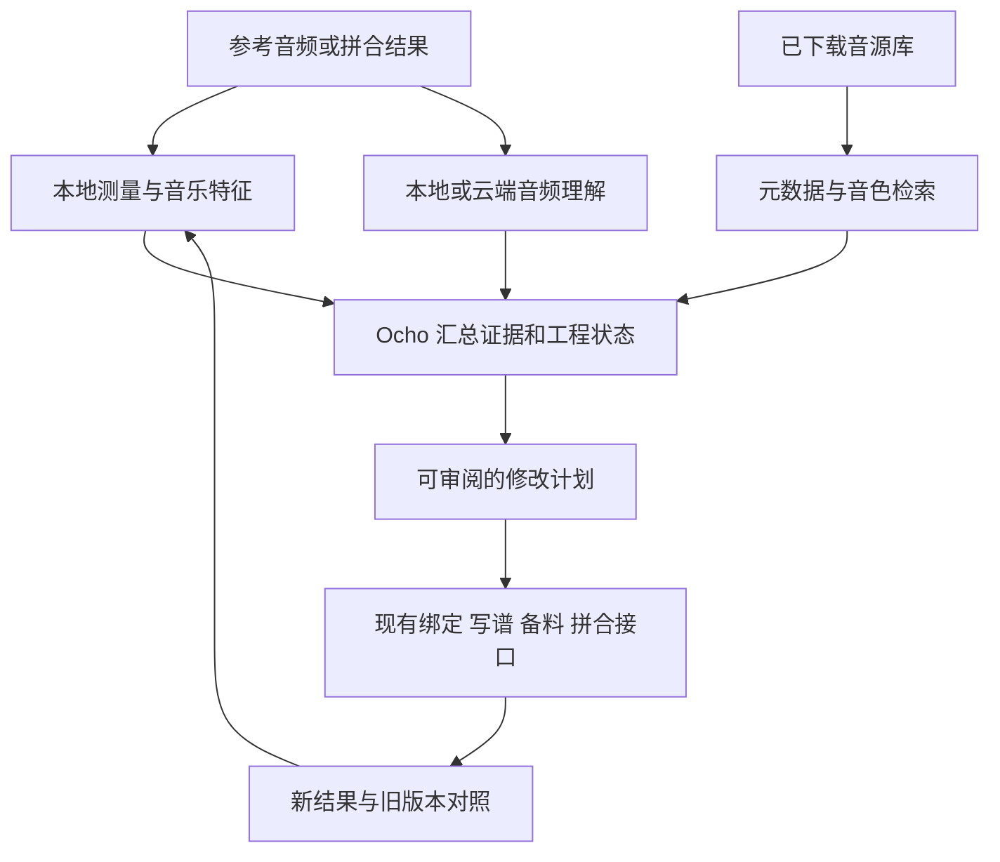

# yovoice 本地模型盘点、音乐理解与云端接入分析

核查日期：2026-10-20。范围：当前整合工作树、当前用户数据库中的模型登记、模型文件路径，以及项目作者和云平台官方资料。

## 一、结论

1. 当前应用目录提供 38 个下载包，分属 10 个家族；本机登记已下载 5 个包，另外 33 个未安装。Q8、F16 等重复精度包不代表不同功能。
2. 已下载的是 IndexTTS 2.5 两种精度、YuE2 3B Q8，以及两套 SF2。它们主要负责说话、生成音乐和播放 MIDI，还没有已接通的音乐音频问答模型。
3. 未下载的 SheetSage2 能把音频中的旋律、和弦转成谱，是最接近现有编曲分析流程的模型，但不能承担所有乐器的精准总谱还原。
4. 真正接收音乐波形并回答问题的方案已经存在。云端可优先评估 Gemini 音频理解和阿里云 Qwen-Omni；开源权重方向可评估 Music Flamingo、Audio Flamingo 3 / Next、Qwen3-Omni。
5. 专业编曲需要组合能力：听感与段落解释、音高节拍测量、音源检索、工程状态检查、实际渲染。一个音频大模型不能替代全部环节。

本次只读盘点了数据库，并核实已登记路径存在，没有重新运行每个模型、下载新权重或上传用户作品。因此“已下载”不等于本轮已验证全部推理能力。

## 二、本机已下载的 5 个包

| 包 | 实际能力 | 对智能编曲的价值 | 不能据此承诺的能力 |
| --- | --- | --- | --- |
| IndexTTS 2.5 Q8 | 参考人声克隆、语音合成、情绪控制 | 旁白、故事、语音内容 | 音乐听辨、乐器分析、专业歌声修音 |
| IndexTTS 2.5 F16 | 同一模型的另一精度版本 | 同上；用于比较资源与效果 | 不会因为精度提高就增加音乐理解能力 |
| YuE2 3B Q8 | 歌曲生成、旋律谱条件下的音乐生成 | 智能编曲的 AI 素材来源 | 对任意成品音乐做可靠的分析问答；保证每种民乐奏法真实 |
| MuseScore General SF2 | 根据 MIDI 音符播放音色 | 乐谱预览、基础演奏 | AI 规划、音频理解；也不能把所有音色都认作独立民乐录音 |
| SGM-V2.01 SF2 | 根据 MIDI 音符播放音色 | 同上 | 同上 |

IndexTTS 的两个包属于同一个模型；两个 SF2 属于音色资源。所以这五个下载包并不是五套互不相同的神经网络能力。

主要目录为 `C:\Users\Administrator\.yovoice\models`。库存快照见 [本轮模型清单](../artifacts/arrangement-audit/local-model-capabilities-inventory-20261020.json)。

## 三、应用里的全部可下载模型分别做什么

以下依据当前应用目录与 [本地模型说明](models_zh.md)，不将目录标注自动当作本机实测结果。

| 家族 | 目录中的主要版本 | 包数 | 本机已装 | 用途及边界 |
| --- | --- | ---: | ---: | --- |
| IndexTTS | 2.0、2.5；Q8/F16/ORIG | 6 | 2 | 参考语音克隆与情绪化说话；不是音乐分析器 |
| VoxCPM2 | Q8/BF16/ORIG | 3 | 0 | 语音设计、克隆、演绎；不能自动完成歌曲后期修音 |
| OmniVoice | Q8/BF16/F16 | 3 | 0 | 语音属性设计与克隆；与 Qwen-Omni 是不同模型 |
| Qwen3-TTS | Base 0.6B/1.7B、CustomVoice、VoiceDesign | 9 | 0 | Base 克隆、CustomVoice 内置说话人、VoiceDesign 文字设计嗓音；不承担音乐问答 |
| Breeze TTS 2 | Q4/Q8/BF16 | 3 | 0 | 中英声音设计、克隆与演绎指导 |
| Kokoro | 82M 1.0、1.1-zh | 3 | 0 | 小型预设语音合成；中文版本为实验性；不是参考音色克隆方案 |
| ACE-Step | 1.5 Turbo、1.5 XL Turbo；Q8/BF16 | 4 | 0 | 风格与歌词驱动的歌曲、配乐生成；不能自动当作精准单乐器采样器 |
| YuE2 | 3B；Q4/Q8/BF16 | 3 | 1 | 生成歌曲和谱条件音乐；与 ACE-Step 是不同生成路线 |
| SheetSage2 | 原始包，F32 权重 | 1 | 0 | 音频转旋律、和弦及 ABC 谱，辅助参考曲分析与翻唱 |
| SoundFont | MuseScore General、GeneralUser GS、SGM-V2.01 | 3 | 2 | MIDI 音色库，不属于神经网络模型 |
| 合计 |  | 38 | 5 |  |

### 精度怎么理解

- Q4、Q8：量化权重，通常用于降低资源占用，具体影响要听测。
- F16、BF16：浮点权重格式，一般占用更多内存；不能仅凭名字判断所有场景质量。
- ORIG：目录中的原始打包版本标记，不表示增加了一种创作能力。
- 下载体积、实际显存占用、运行时内存是三个不同指标，不能用安装包体积直接推断显卡是否足够。

对你的需求，继续下载多个 TTS 对“琵琶与箫智能编曲”帮助有限。现有目录中优先值得研究的是 SheetSage2 的参考音频转谱，以及 AI 音乐生成模型的乐句条件控制。

## 四、什么才算听懂音乐

| 层次 | 输入和输出 | 应用中的例子 |
| --- | --- | --- |
| 声学测量 | 波形 → 时长、静音、削波、响度、能量与频谱变化 | 找拼合接缝、突兀音量变化；不需要大语言模型 |
| 音乐信息提取 | 波形 → 节拍、重拍、音高、音符、和弦候选 | 判断乐句有没有跟上谱、哪里错位 |
| 音色表征与检索 | 波形/描述 → 特征向量、相似候选 | 在已下载音源里找相似音色 |
| 音乐语义问答 | 波形 + 问题 → 乐器、结构、情绪和听感解释 | “中段是否加入了另一件拨弦乐器？” |
| 创作执行 | 计划 + 工程 + 工具 → 修改、渲染、结果复查 | Ocho 选择源、生成一句、重新拼合 |

这些层次不能相互代替。模型能流畅写乐理分析，不等于已经听到了文件；能读 MIDI 推理，也不等于能准确识别同一段录音。已有研究在旧一代 Gemini 和 Qwen2.5-Omni 的音频与 MIDI 对照中发现了明显感知差距；这不能直接当作最新模型的成绩，但说明验收必须用实际音频。[研究论文](https://arxiv.org/abs/2510.22455)

## 五、现成的开源与开放权重方案

| 项目 | 能力类型 | 建议用途 | 主要限制 |
| --- | --- | --- | --- |
| [Music Flamingo](https://huggingface.co/nvidia/music-flamingo-2601-hf) | 音乐音频问答、结构与音乐语义解释 | 专项音乐分析候选 | 8B；非商业许可；民乐识别仍需实测 |
| [Audio Flamingo Next](https://huggingface.co/nvidia/audio-flamingo-next-hf) / [系列仓库](https://github.com/NVIDIA/audio-flamingo) | 语音、音乐、环境声理解 | 通用听音问答候选 | Next 为 8B，支持长音频；非商业许可 |
| [Qwen3-Omni](https://github.com/QwenLM/Qwen3-Omni) | 多模态理解，包括音频 | 中文交互与音频理解评估 | 30B-A3B 中的 3B 是激活参数量，不能当成完整权重大小 |
| [Qwen2-Audio](https://github.com/QwenLM/Qwen2-Audio) | 音频问答 | 较早的音频理解基线 | 不应因架构成熟就跳过民乐测试 |
| [MuQ / MuQ-MuLan](https://github.com/tencent-ailab/MuQ) | 音乐表征、音乐与中英文文本匹配 | 音源库语义检索、参考曲相似素材搜索 | 不会直接对话；代码 MIT，公开权重 CC-BY-NC 4.0 |
| [MERT](https://github.com/yizhilll/MERT) | 音乐自监督特征 | 后续训练/接入专用音乐分类器 | 不是即用聊天分析器；[330M 权重](https://huggingface.co/m-a-p/MERT-v1-330M) 为 CC-BY-NC 4.0 |
| [CLAP](https://github.com/LAION-AI/CLAP) | 音频与文字相似度 | 音效和音源搜索 | 相似分数不等于乐器身份或奏法的鉴定结果 |
| [Beat This!](https://github.com/CPJKU/beat_this) | 节拍与重拍跟踪 | 时间网格、乐句对齐 | 自由速度和散板不能强行按固定网格判断；代码和发布权重为 MIT |
| [Basic Pitch](https://github.com/spotify/basic-pitch) | 音频转 MIDI、弯音 | 独立声部旋律检查 | 官方建议一次处理一种乐器；不能代替混合乐队的精准总谱 |
| [Demucs](https://github.com/facebookresearch/demucs) | 音频分离 | 先分离常见声部再分析 | 原仓库已归档；标准声部分离不等于能拆出琵琶、箫等所有民乐 |

Music Flamingo 的模型卡说明其面向音乐问答，支持较长音乐输入；HF 版本上限为 20 分钟。它可以作为专项候选，但当前模型卡没有现成 Inference Provider 部署，不能把“有权重”写成“已经有可直接购买的 API”。[模型卡](https://huggingface.co/nvidia/music-flamingo-2601-hf)

MuQ-MuLan 更适合给库内素材建立检索索引。搜索“温润箫长音”“清脆拨弦”可以返回候选；“轮指”“挑弹”是否真正演奏出来，还需要人工标注、专用检测和试听来建立可靠性。[项目说明](https://github.com/tencent-ailab/MuQ)

## 六、云端哪些模型可以做到

### 6.1 阿里云百炼 Qwen-Omni：优先做接入评估

截至本轮查询，官方 HTTP 文档将 `qwen3.8-omni-flash` 用于音视频理解和文本分析，直接接受 `input_audio`；还提供思考、工具调用和联网搜索。旧的 Qwen3-Omni-Flash 与提供语音输出的 Qwen3.5-Omni 路线也需按控制台实际权限选择。[官方调用文档](https://help.aliyun.com/zh/model-studio/qwen-omni)

**建议用途（待实测）**：参考曲的中文描述、声部进入/退出分析、听感问题解释，再让 Ocho 查询工程与采样库。通用音频支持并不能证明准确识别箫/竹笛或琵琶奏法，必须建立你的专项测试集。

接入时不能只改一个模型名。现有纯文本请求必须增加音频载荷、格式转换、上传范围、超时、重试、分段、费用记录和失败状态。OpenAI 兼容格式也不表示现有文字适配器自动支持音频。

### 6.2 Gemini 音频理解 API：作为另一条对照路线

官方文档提供真实音频输入、内容问答、音乐情绪分析和按时间段分析；可以直接传音频或使用文件上传。当前页面示例使用 `gemini-3.8-flash`，接入时仍应核对项目可用模型和区域权限。[官方音频文档](https://ai.google.dev/gemini-api/docs/audio?hl=en)

**建议用途（待实测）**：整曲结构、前后段变化、参考曲与成品的差异解释，以及与 Qwen-Omni 进行盲测对照。它对中国民乐的精确辨识率，本次没有实验依据，不能直接排序为“最懂民乐”。

### 6.3 自建云端音乐理解服务

Music Flamingo、Audio Flamingo 等可以评估部署到独立 GPU 服务，让本机应用只发送选定片段、接收分析结果。这属于自行部署路线，仍有服务维护、许可和算力成本，不等于现成免配置 API。

### 6.4 云端使用边界

- 只需文本分析时，不必启用语音输出或实时语音对话。
- 文件路径和 `localhost` 地址不能让云服务直接访问本机音频；必须有受控传输机制。
- 未发布作品应能选择“仅本地”“允许本次上传片段”等范围，并展示实际上传对象。
- 价格、额度和账号权限会变，本报告未调用付费 API，也没有给出未经验证的每首费用。
- 只做 ASR 的接口、TTS 接口、音乐生成接口，不能自动替代音频理解接口。
- 现有 DeepSeek 文字规划可以继续用；需要让它收到实际听音工具的结果，而不是把文件名当成已经听过的证据。

## 七、当前应用的接入基础与缺口

### 已有基础

1. 当前随应用打包的引擎含 `audio_flamingo.json`，声明 Audio Flamingo 3 / Next、音频问题指令 `instruct`，并列出 Q4_K/Q8/BF16 包，默认建议 Next Q4_K。
2. 底层文档已经说明音乐、语音和环境音问答。AF3、Next 的支持范围与时长限制必须按实际引擎版本处理。[audio.cpp v0.9.1 说明](https://raw.githubusercontent.com/0xShug0/audio.cpp/v0.9.1/docs/models/audio_flamingo.md)
3. 引擎还包含 HTDemucs 规范，可作为分离能力的评估基础。

### 还没接通的部分

1. yovoice 自身 38 包目录没有 Audio Flamingo，无法把引擎规范的存在当作用户已下载可用。
2. `internal/engine/engine.go` 的 `Transcribe` 明确限定 `sheetsage2`，没有通用音乐问答调用路径。
3. `internal/workbench/arrangement_reference.go` 的参考分析仍调用 `CoverMelody`，实质是扒谱入口。
4. Ocho 缺少已经验证的“读取实际音频 → 语义听辨 → 返回带证据的结果 → 定位工程声部”的通路。
5. Music Flamingo 与 Audio Flamingo 是不同模型变体；不能因为同一作者或相近名称就保证现有引擎可以直接加载。

因此，本轮建议的第一步是补齐独立音乐分析接口与可验证工具调用，不是继续增加一些与音乐理解无关的 TTS 下载项。

## 八、按你的编曲场景组合能力

### 场景 A：90 秒琵琶与箫，有轮指与挑弹

1. 工程数据库先确认真实音源身份、奏法、音域、文件健康与许可。
2. 检索工具只在满足硬条件的候选中排序，优先已下载素材。
3. 规划模型安排独奏、合奏、留白和奏法，生成结构化方案。
4. 实际渲染后再检查有没有轮指段、箫是否被其他声部遮盖、段落是否合理。
5. 音频理解的判断作为待验证建议，不能覆盖已经确认的文件身份或假称发现了不存在的真实采样。

### 场景 B：拼合之后一顿一顿

先测每个接缝的真实时间位置、静音长度、波形突变、包络、响度、采样率和重叠。再检查乐句发音是否重新起音、延音是否被切掉、速度网格是否一致，最后让听音模型评价听感变化。

不能仅问大模型“是不是 AI 味太重”，就让它猜 EQ 参数。工程证据能区分：文件之间真的有空隙、采样自身尾音短、重复触发造成停顿，或模型生成的内部节奏不一致。这些问题需要不同修复。

### 场景 C：参考曲分析

语义模型概括情绪、段落和音色；SheetSage2/专用转谱工具给旋律候选；节拍工具给时间坐标；用户确认后规划新的编曲。分析结果与原音频一起保留来源、片段范围、模型版本及不确定性。

## 九、Ocho 应增加的接口与结果约束（建议，尚未实现）

| 接口 | 责任 | 必须返回 |
| --- | --- | --- |
| `music.inspectAudio` | 基础声学检查 | 文件哈希、时长、测量方法、静音/削波等事件 |
| `music.analyze` | 真正调用音频理解模型 | 使用的音频片段、模型、观察、推测、未知项 |
| `music.extractFeatures` | 专用节拍/音高/转谱 | 时间基准、方法与候选结果 |
| `library.searchAudio` | 元数据和语义检索 | 本地可用性、来源、奏法、匹配原因 |
| `arrangement.compareAudio` | 新旧结果对照 | 对应修订、差异时间段、测量和听感分别记录 |

接口名字为提案。结果应区分“数据库确认”“信号测量”“模型推测”“用户标注”。自报置信度没有校准前不能包装成准确率。若没有读取音频、模型超时或无可用权重，Ocho 必须明确报告未完成听辨。

## 十、硬件与迭代顺序

本机核查为 RTX 4060 Laptop 约 8GB 显存、约 16GB 内存。大型音频语言模型的原始 BF16 权重及运行缓存可能超过现有资源。当前引擎已有 AF Next Q4_K 包规范，值得做短片段实机测试，但本轮未下载、未测速度或显存，不能保证顺畅运行。也不建议同时加载 YuE2 与大型分析模型。

建议顺序：

1. **先做测量闭环**：时长、静音、削波、接缝、谱与文件对齐；Ocho 能引用工程事实。
2. **评估云端听音**：Qwen-Omni 与 Gemini 使用同一组匿名化/获准片段，按任务对照，选主用和备用。
3. **接 SheetSage2 与专用节拍工具**：服务参考曲和渲染后对齐检查；保持原有生成入口。
4. **评估本地 AF Next Q4_K**：验证 Windows 内核调用、量化质量、时延、内存和音乐问答；处理模型许可。
5. **增加库内语义检索**：优先调研 MuQ-MuLan/CLAP，结合真实元数据过滤；检查权重许可。
6. **专项音乐模型对照**：在独立资源条件允许时评估 Music Flamingo，不把通用榜单当作民乐验收。

### 验收用例

- 琵琶/古筝、箫/竹笛、二胡/小提琴等易混音色；单声部与混合编曲分别测。
- 轮指/单次挑弹/普通重复音；是否能在混音中定位出现区间。
- 有节拍与散板分别测；允许“不确定”与多个候选。
- 人工植入静音接缝、短尾音、削波、错位、故意不同速度，再测定位结果。
- 隐去文件名和计划提示，避免模型从标题猜答案；设置音频与标题矛盾的对照。
- 评价乐器准确率、事件定位误差、误报、拒答合理性、时延、峰值内存与每次费用。
- 模型分析结果不能直接覆盖用户手工编辑；每次修复都能撤销、重听和与原版比较。

## 十一、最终建议

保留现有生成模型和真实采样演奏体系，新增一层“能读取实际结果的音乐分析”。Ocho 继续负责计划与工具调度，云端或本地音频模型负责语义听辨，专用工具负责可测量的音高与时间问题。

优先评估 **Qwen-Omni 云端 + 本地信号检查/转谱** 的组合，同时以 Gemini 做对照；本地长期候选优先利用现有引擎的 Audio Flamingo 支持。是否胜任中国民乐，最终取决于上述实测，不以模型名称或宣传描述作为结论。
